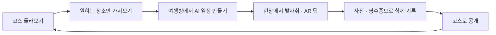
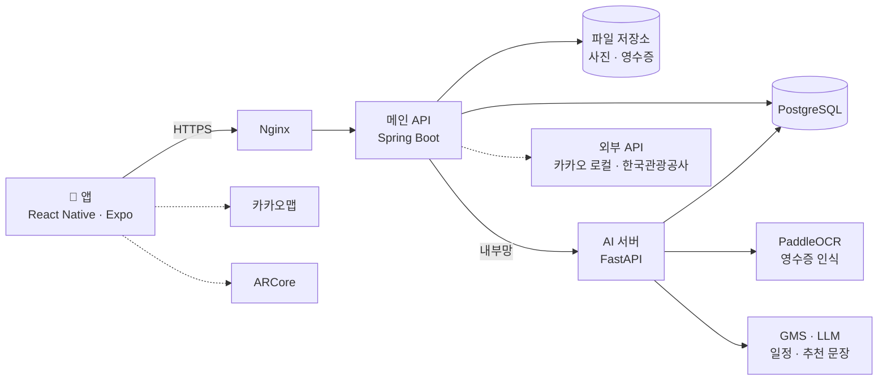

<p align="center">
  
</p>

<p align="center">
  <b>다른 사람의 발자취를 따라 여행하고, 나의 발자취는 또 다른 사람의 여행이 되는 여행 코스 공유 서비스</b>
</p>

<p align="center">
  SSAFY 자율 프로젝트 · A109 · 2026.10 ~ 2026.11 <!-- TODO: 시작일 ~ 발표일 -->
</p>

---

## 목차

1. [소개](#소개)
2. [핵심 기능](#핵심-기능)
3. [시연](#시연)
4. [시스템 구조](#시스템-구조)
5. [기술 스택](#기술-스택)
6. [저장소 구조](#저장소-구조)
7. [시작하기](#시작하기)
8. [협업 규칙](#협업-규칙)
9. [문서](#문서)
10. [팀](#팀)

---

## 소개

여행의 세 단계, **발견 → 계획 → 기록**은 서로 끊겨 있습니다.

| 단계 | 지금의 불편함 | 여기록의 해결 |
| --- | --- | --- |
| 발견 | 검색하면 비슷한 장소만 반복해서 나온다 | 실제로 다녀온 사람들의 코스와 발자취에서 장소를 찾는다 |
| 계획 | 남의 코스는 내 이동 수단과 일행 상황에 맞지 않는다 | 원하는 장소만 가져와 일행과 모으고, AI가 이동 시간을 반영한 일정 초안을 만든다 |
| 기록 | 사진은 각자의 휴대폰에, 영수증은 결제한 사람에게 흩어진다 | 일행의 사진과 영수증을 모아 AI가 일정 초안을 만들고, 함께 여행기를 완성한다 |

완성된 여행기는 다시 새로운 코스로 공개되고, 다른 사람의 여행이 시작되는 출발점이 됩니다.



---

## 핵심 기능

| 기능 | 하는 일 |
| --- | --- |
| **코스 탐색** | 지역과 7개 카테고리로 공개 코스를 찾고, 코스 상세에서 원하는 장소만 골라 여행방에 담습니다. |
| **여행방** | 일행을 초대해 가고 싶은 장소를 함께 모읍니다. 장소마다 공유 코스·검색·AI 추천 중 어디서 가져왔는지 남습니다. |
| **AI 일정** | 담은 장소와 이동 수단(자차·대중교통)으로 이동 시간을 반영한 일정 초안을 만들고, 순서와 머무는 시간을 조정합니다. |
| **발자취** | 방문한 장소에 "다녀감"을 남기면 위치만 모여, 지도에서 사람들이 요즘 많이 찾는 곳을 볼 수 있습니다. 함께 쓴 방명록은 본인만 봅니다. |
| **AR 팁** | 현장에서 카메라로 먼저 다녀간 사람이 남긴 팁을 보고, 나도 그 자리에 팁을 남깁니다. |
| **AI 여행 기록** | 일행이 올린 사진과 영수증(OCR)으로 방문 일정 초안을 만들고, 일정마다 사진과 이야기를 채워 여행기를 완성합니다. |
| **코스 공개** | 완성한 기록을 경로와 사진 중심의 코스로 공개합니다. 이야기·영수증·방명록은 공개되지 않습니다. |

---

## 시연

<!-- TODO: 개발 완료 후 화면 GIF와 시연 영상 링크를 넣는다. GIF는 docs/images/ 아래에 둔다. -->

| 코스 탐색 | 여행방 · AI 일정 | AR 팁 | AI 여행 기록 |
| :---: | :---: | :---: | :---: |
| <!--  --> TODO | TODO | TODO | TODO |

---

## 시스템 구조

> 개발 중인 구성입니다. 확정되면 이 그림을 갱신합니다.



- 앱은 메인 API만 호출합니다. AI 서버는 외부에 열지 않고 메인 API를 통해서만 접근합니다.
- 테이블은 메인 API의 마이그레이션으로만 만듭니다. AI 서버는 같은 DB를 읽기 위주로 사용합니다.

---

## 기술 스택

| 파트 | 사용 기술 |
| --- | --- |
| **Frontend** | Expo SDK 58 · React Native 0.88 · React 19 · TypeScript · Expo Router · NativeWind 4 · pnpm |
| **Backend** | Java 21 · Spring Boot 4.0 · Spring Security(OAuth2 Resource Server) · Spring Data JPA · PostgreSQL · springdoc-openapi(Swagger) · Gradle |
| **AI** | Python · FastAPI · PaddleOCR 3.7 · PaddlePaddle 3.3 · MLflow · OpenCV · GMS(LLM) |
| **Infra** | Docker Compose · Nginx · AWS EC2 <!-- TODO: CI/CD 도구 확정 후 추가 --> |
| **외부 서비스** | 카카오(로그인 · 지도 · 로컬) · Google 로그인 · ARCore · 한국관광공사 TourAPI |
| **협업** | GitHub · Jira · Notion · Figma · Discord |

<!-- 프론트엔드에 도입 예정인 패키지(TanStack Query, Zustand, axios, React Native Reusables, Maestro)는 설치 후 표에 옮긴다. -->

---

## 저장소 구조

```
Yeogirok/
├─ frontend/    앱 (React Native · Expo)
├─ backend/     메인 API (Spring Boot)
├─ ai/          AI 서버 · OCR 학습 (FastAPI · PaddleOCR)
├─ infra/       배포 설정 (Docker Compose · Nginx)
├─ docs/        공통 문서 (컨벤션)
└─ .github/     PR 템플릿 · 워크플로
```

- 각 폴더의 내부 구조와 세부 규칙은 해당 파트가 관리하며, 폴더마다 README가 있습니다.
- `AGENTS.md`, `CLAUDE.md`, `.claude/`는 AI 코딩 에이전트용 작업 규칙입니다.

---

## 시작하기

```bash
git clone https://github.com/SSAFY-A109/Yeogirok.git
cd Yeogirok
```

환경 변수는 파트마다 `.env.example`을 복사해 `.env`로 씁니다. **`.env`와 API 키는 절대 커밋하지 않습니다(공개 저장소).**

### Frontend

- 필요: Node.js LTS, pnpm(`corepack enable`)

```bash
cd frontend
pnpm install
pnpm start
```

지도·AR·카메라는 Expo Go에서 동작하지 않아 개발 빌드가 필요합니다. 자세한 설치 순서는 [frontend/README.md](frontend/README.md)와 [frontend/docs/setup.md](frontend/docs/setup.md)를 봅니다.

### Backend

- 필요: JDK 21, PostgreSQL <!-- TODO: 로컬 DB용 docker-compose.local.yml 추가 후 실행 명령으로 교체 -->

```bash
cd backend
cp .env.example .env      # DB_URL, DB_USERNAME, DB_PASSWORD
./gradlew bootRun
```

실행 후 API 문서: http://localhost:8080/swagger-ui.html

### AI

- 필요: Python <!-- TODO: 버전 -->

```bash
cd ai/ocr
pip install -r requirements.txt
```

`requirements.txt`는 GPU용 `paddlepaddle-gpu`를 씁니다. GPU가 없는 환경에서는 CPU용 `paddlepaddle`로 바꿔 설치합니다. AI 서버 실행 방법은 `ai/README.md`에 추가합니다. <!-- TODO -->

### Infra

<!-- TODO: 서버 Compose와 배포 방법이 정해지면 infra/README.md 링크를 둔다. -->
준비 중입니다.

---

## 협업 규칙

| 항목 | 규칙 | 문서 |
| --- | --- | --- |
| 브랜치 | `<part>/<type>/<Jira 이슈 키>-<작업내용>` · 기능 브랜치 → `<part>/dev` → `main` | [branch.md](docs/conventions/branch.md) |
| 커밋 | `<type>: <subject>` · 꼬리말에 Jira 이슈 키 | [commit.md](docs/conventions/commit.md) |
| PR | 템플릿을 따르고, base는 `<part>/dev`로 지정 (`common/docs`만 `main`) | [PR 템플릿](.github/pull_request_template.md) |
| 보호 | `main`과 `<part>/dev`에는 직접 push하지 않고 PR로만 병합 | |
| 이슈 | Jira `S15P31A109-*` | |

---

## 문서

<!-- 팀 내부 문서는 공개 저장소에서 접근 권한이 없을 수 있다. 공개해도 되는 문서만 링크를 연다. -->

| 문서 | 위치 |
| --- | --- |
| 기능 명세서 | Notion (팀 내부) <!-- TODO: 링크 --> |
| API 명세 | Notion (팀 내부) · 배포 후 Swagger <!-- TODO: 링크 --> |
| ERD | Notion (팀 내부) <!-- TODO: 이미지 또는 링크 --> |
| 와이어프레임 · 디자인 | Figma (팀 내부) <!-- TODO: 링크 --> |
| 프론트 기능 명세 요약 · API 계약 사본 | [frontend/docs](frontend/docs) |

---