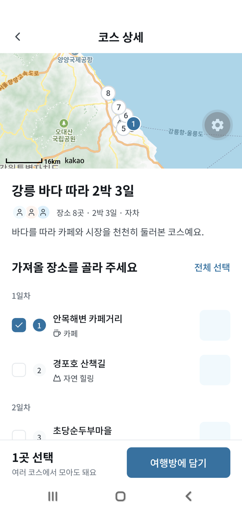
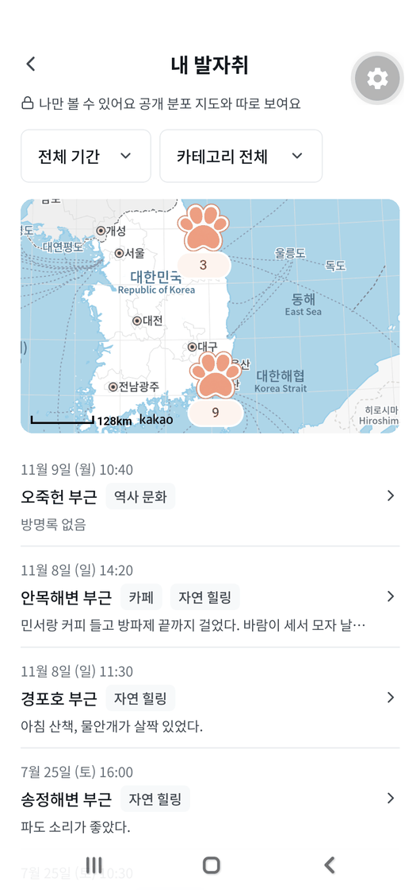
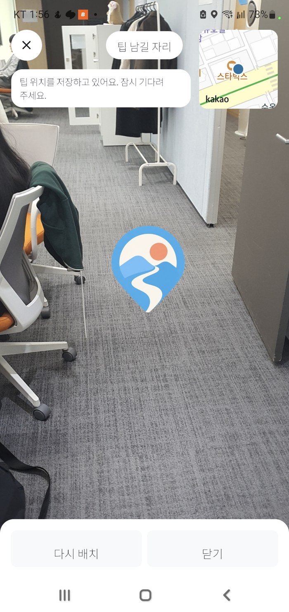
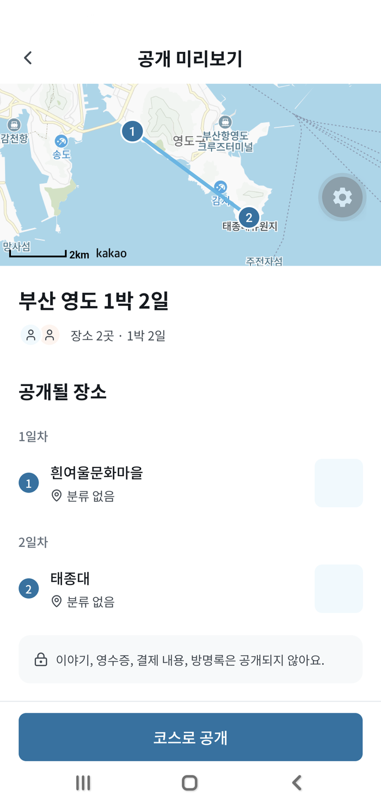
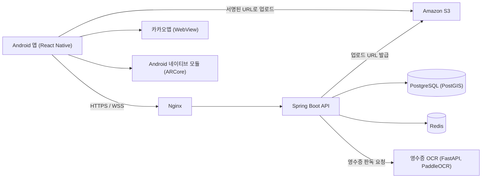
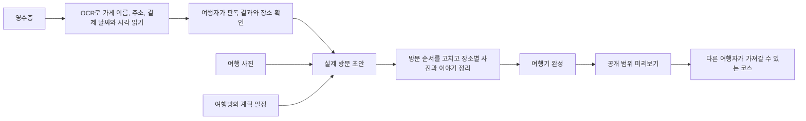

<p align="center">
  
</p>

<h1 align="center">여기록</h1>

> 다른 여행자의 코스에서 가고 싶은 곳을 골라 일행과 일정을 짜는 Android 앱입니다. 여행을 마치면 함께 찍은 사진과 영수증으로 여행기를 만듭니다.

강릉 여행기에서 안목해변 카페거리가 마음에 들었다면 그 장소만 내 여행방에 담을 수 있습니다. 일행이 가고 싶은 곳까지 모아 이틀간의 동선을 짭니다. 다녀온 뒤 코스를 공개하면 다른 여행자도 마음에 드는 곳을 골라 담을 수 있습니다.

**SSAFY 자율 프로젝트 A109팀** &nbsp; | &nbsp; 2026.10 – 2026.11 &nbsp; | &nbsp; [프로젝트 저장소](https://github.com/SSAFY-A109/Yeogirok)

## 목차

1. [프로젝트 소개](#프로젝트-소개)
2. [주요 기능](#주요-기능)
3. [사용자 이용 흐름](#사용자-이용-흐름)
4. [주요 화면](#주요-화면)
5. [시스템 아키텍처](#시스템-아키텍처)
6. [여행 기록 데이터 흐름](#여행-기록-데이터-흐름)
7. [핵심 도메인 관계](#핵심-도메인-관계)
8. [핵심 기술](#핵심-기술)
9. [기술 스택](#기술-스택)
10. [프로젝트 구조](#프로젝트-구조)
11. [관련 문서](#관련-문서)
12. [팀원과 기여](#팀원과-기여)

---

## 프로젝트 소개

| 여행할 때 겪는 불편                                                                | 여기록에서 할 수 있는 일                                                                |
| ---------------------------------------------------------------------------------- | --------------------------------------------------------------------------------------- |
| 여행기를 읽고 마음에 든 장소를 지도에서 다시 검색해야 합니다.                      | 공개 코스에 있는 장소를 선택해 내 여행방으로 바로 가져옵니다.                           |
| 가고 싶은 곳을 다 모아도 하루에 어디까지 갈 수 있을지 알기 어렵습니다.             | 후보 장소와 이동 수단으로 일정 초안을 만들고 날짜별 방문 순서와 체류 시간을 조정합니다. |
| 돌아오면 사진은 각자의 휴대폰에, 가게 이름과 방문 시각은 영수증에 흩어져 있습니다. | 사진과 영수증을 모아 어디에 언제 들렀는지 확인하고 장소마다 이야기를 남깁니다.          |

## 주요 기능

| 기능                        | 이용 방법                                                                                                                                                                                                                                |
| --------------------------- | ---------------------------------------------------------------------------------------------------------------------------------------------------------------------------------------------------------------------------------------- |
| **코스 탐색과 장소 담기**   | 지역이나 여행 기간, 이동 수단으로 공개 코스를 검색합니다. 지도와 날짜별 방문지를 보고 원하는 장소만 기존 여행방이나 새 여행방에 담습니다.                                                                                                |
| **여행방과 AI 일정**        | 초대 링크로 들어온 일행과 채팅으로 갈 곳을 의논합니다. 여행방에는 직접 검색한 곳과 추천받은 곳을 함께 담습니다. 자동차와 대중교통 중 하나를 고르면 AI가 일정을 제안합니다. 초안을 보고 장소를 다른 날로 옮기거나 머무는 시간을 바꿉니다. |
| **발자취 지도**             | 방문한 곳에서 카테고리를 고르고 나만 보는 방명록을 남깁니다. 방문 분포 지도에는 지역마다 발자취가 몇 개 남았는지 표시됩니다. 내 발자취 지도에서 장소를 누르면 그날 쓴 방명록이 열립니다.                                                 |
| **현장 AR 팁**              | 현장에서 카메라를 비춰 먼저 다녀간 사람이 남긴 팁을 찾습니다. 직접 팁을 쓸 때는 알려 주고 싶은 자리에 핀을 놓고 주변을 여러 각도에서 스캔합니다.                                                                                         |
| **공동 여행기와 코스 공개** | 여행 사진과 영수증을 올려 어디에 어떤 순서로 들렀는지 확인하고 장소마다 사진과 이야기를 붙입니다. 공개 전에는 다른 여행자에게 보일 경로와 사진을 미리 확인합니다.                                                                        |

## 사용자 이용 흐름

| 여행 전                             | 여행 중                                | 여행 후                           |
| ----------------------------------- | -------------------------------------- | --------------------------------- |
| 공개 코스에서 장소 선택             | 지도에서 현재 위치 확인                | 일행의 사진과 영수증 모으기       |
| 여행방에 담고 일행 초대             | 방문한 곳에 발자취와 방명록 남기기     | 영수증 판독 결과와 방문 순서 확인 |
| AI가 짠 일정에서 날짜와 순서 바꾸기 | 카메라로 주변 팁을 보거나 새 팁 남기기 | 장소별 이야기 작성 후 코스 공개   |

## 주요 화면

Android 앱 화면입니다. 코스 화면은 실제 서버에서 받은 관광공사 코스이고, 나머지는 예시 여행을 열어 본 화면입니다. 발자취 GIF는 지도를 확대해 방명록을 읽는 과정을 캡처한 세 장을 이어 붙였습니다.

|                                                      코스에서 장소 고르기                                                      |                                                        내 발자취에서 방명록 열기                                                        |
| :----------------------------------------------------------------------------------------------------------------------------: | :-------------------------------------------------------------------------------------------------------------------------------------: |
|  |  |
|                           강릉 코스의 네 장소 중 오죽헌과 선교장 두 곳만 골라 여행방에 담습니다. 장소 사진은 한국관광공사 TourAPI에서 받습니다.                           |          발바닥 안의 숫자는 그 주변에 남긴 발자취 수입니다. 방문 목록에서 안목해변을 열면 그날의 메모를 다시 읽을 수 있습니다.          |

|                                                           카메라로 AR 팁 배치하기                                                           |                                                                  공개할 코스 미리보기                                                                  |
| :-----------------------------------------------------------------------------------------------------------------------------------------: | :----------------------------------------------------------------------------------------------------------------------------------------------------: |
|  |  |
|                         핀을 놓은 자리를 카메라 영상 위에서 확인합니다. 오른쪽 위 작은 지도에는 핀 주변이 보입니다.                         |           흰여울문화마을과 태종대를 잇는 경로가 어떻게 보일지 확인합니다. 장소에 쓴 이야기와 방명록, 영수증과 결제 내역은 공개하지 않습니다.           |

---

## 시스템 아키텍처



앱은 메인 API에서 여행방과 기록을 조회합니다. 사진과 영수증은 API가 발급한 URL로 S3에 직접 올립니다. 영수증 판독은 서버 내부의 OCR 서비스가 맡습니다. 지도는 WebView에 띄우고 공간 추적이 필요한 AR 카메라는 Kotlin 모듈에서 실행합니다.

## 여행 기록 데이터 흐름



영수증에서 가게 이름만 읽혔거나 같은 이름의 가게가 여러 곳이면 여행자가 가게와 결제 시각을 확인합니다. 앱은 확인한 영수증과 여행 사진, 원래 일정을 모아 방문 초안을 만듭니다. 중간에 계획이 바뀌었다면 실제로 들른 순서대로 고칩니다.

## 핵심 도메인 관계

| 도메인             | 다른 데이터와 맺는 관계                                                                                                                  |
| ------------------ | ---------------------------------------------------------------------------------------------------------------------------------------- |
| **여행방**         | 일행, 후보 장소, 날짜별 계획 일정을 묶습니다. 여러 공개 코스에서 가져온 장소도 한 여행방에 모을 수 있습니다.                             |
| **여행 기록**      | 들른 곳을 날짜별로 정리합니다. 방문한 순서대로 사진을 보고 그곳에서 일행이 쓴 이야기를 읽을 수 있습니다.                                 |
| **공개 코스**      | 여행기에서 방문 장소와 경로를 가져옵니다. 사진은 공개할 때 고른 것만 보여 줍니다. 다른 여행방에서는 이 코스의 장소를 선택해 가져갑니다.  |
| **발자취와 AR 팁** | 발자취에는 방문 위치와 나만 보는 방명록이 남습니다. AR 팁은 내용과 공간 앵커를 함께 저장해 다음 방문자가 그 자리에서 팁을 찾도록 합니다. |

## 핵심 기술

### 일정 순서를 바꾼 뒤의 이동 시간

여행자가 장소를 다른 날로 옮기면 그 전후에 이동할 구간도 달라집니다. 앱은 기존 초안에서 알 수 있는 시각을 먼저 갱신하고 새로 생긴 이동 구간은 **계산 전**으로 표시합니다. 장소를 연달아 옮기면 마지막 편집을 기준으로 서버에 재계산을 요청합니다. 하루 일정에 시간이 모자라 빠진 곳은 그날의 종료 시각을 늦춰 다시 넣을 수 있습니다.

### 끊겼던 여행방 채팅 복구

채팅 중 앱을 백그라운드로 보내면 WebSocket 연결을 닫습니다. 앱에 돌아오면 마지막으로 받은 메시지 ID 이후의 이력을 조회하고 새로 도착한 메시지와 합칩니다. 이력 조회와 실시간 수신이 겹쳐도 같은 ID의 메시지는 한 번만 표시합니다.

### 현장에서 같은 자리에 AR 핀 표시

팁을 남길 때 앱은 핀 주변을 여러 각도에서 비춰 달라고 안내하고 ARCore Cloud Anchor에 공간 정보를 저장합니다. 다음 방문자는 주변 팁을 조회한 뒤 카메라로 공간을 인식해 핀을 복원합니다. 기기가 깊이 정보를 제공하면 앱은 벽 뒤에 가려진 핀을 숨기고 터치 대상에서도 뺍니다.

## 기술 스택

| 영역                 | 기술                                                                               |
| -------------------- | ---------------------------------------------------------------------------------- |
| 모바일               | React Native 0.88, Expo SDK 58, TypeScript, Expo Router, NativeWind                |
| 데이터 통신과 테스트 | TanStack Query, Axios, WebSocket, MSW, Maestro                                     |
| 지도와 AR            | 카카오맵 JavaScript SDK, React Native WebView, Kotlin, Google ARCore Cloud Anchors |
| 백엔드               | Java 21, Spring Boot 4, Spring Security, Spring Data JPA, Flyway                   |
| 영수증 인식          | Python, FastAPI, PaddleOCR, OpenCV                                                 |
| 저장소와 배포        | PostgreSQL, PostGIS, Redis, Amazon S3, AWS EC2, Docker Compose, Nginx, Jenkins     |

## 프로젝트 구조

앱과 서버, 인프라 코드는 원본 저장소의 파트별 개발 브랜치에서 관리합니다.

```text
Yeogirok/
├── frontend/
│   ├── app/          # Expo Router 화면 진입점
│   ├── features/     # 코스, 여행방, 일정, 발자취, AR 팁, 여행 기록
│   ├── api/          # HTTP 클라이언트와 개발용 API 모의 응답
│   └── native/ar/    # Android ARCore 카메라와 공간 앵커
├── backend/          # 메인 API와 데이터베이스 마이그레이션
├── ai/ocr/           # 영수증 인식 서버와 텍스트 추출
├── infra/            # 컨테이너와 프록시 설정, 배포 스크립트
└── docs/             # 프로젝트 공통 문서
```

## 관련 문서

- [프론트엔드 기능 명세와 화면 흐름](https://github.com/SSAFY-A109/Yeogirok/blob/frontend/dev/frontend/docs/frontend-spec.md)
- [Android AR 모듈의 핀 배치와 복원 구현](https://github.com/SSAFY-A109/Yeogirok/blob/frontend/dev/frontend/native/ar/SOURCE.md)
- [영수증 OCR 응답 필드와 판독 상태](https://github.com/SSAFY-A109/Yeogirok/blob/ai/dev/ai/ocr/ocr_response.py)
- [배포 구성과 인프라 운영 문서](https://github.com/SSAFY-A109/Yeogirok/blob/infra/dev/infra/README.md)

## 팀원과 기여

| 이름   | 역할      |
| ------ | --------- |
| 김재영 | FE, Infra |
| 황용진 | FE        |
| 서보영 | BE, Infra |
| 정보경 | BE        |
| 김재원 | AI        |
