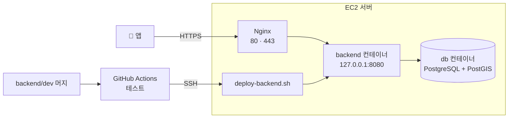

# 여기록 인프라

서버 한 대(EC2)에 Docker Compose로 DB와 백엔드(이후 AI 서버)를 띄우고, Nginx로 HTTPS를 붙이고, `backend/dev`에 머지되면 GitHub Actions가 자동으로 배포하는 구성입니다. 인프라를 처음 맡는 사람이 위에서부터 순서대로 따라 하면 되도록 썼습니다.

## 한눈에 보기



- 바깥에서 들어오는 길은 **Nginx(80·443) 하나**입니다. DB(5432)와 백엔드(8080)는 서버 안에서만 열립니다.
- 테이블은 **백엔드의 Flyway(마이그레이션)만** 만듭니다. AI 서버도 같은 DB를 쓰지만 테이블을 만들지 않습니다.
- 역할 경계: 컨테이너 바깥(서버, 도메인, HTTPS, DB 인스턴스, 배포, 비밀값)은 인프라, 컨테이너 안(코드, 스키마, 설정 프로필)은 각 파트가 맡습니다.

## 파일

| 파일 | 하는 일 | 쓰는 곳 |
| --- | --- | --- |
| `infra/docker-compose.local.yml` | 로컬 개발용 DB | 팀원 노트북 |
| `infra/docker-compose.yml` | 서버의 DB·백엔드(·AI) 구성 | 서버 |
| `infra/.env.example` | 서버 비밀값 목록 (값은 비워 둠) | 서버에서 `.env`로 복사 |
| `infra/nginx/yeogirok.conf` | HTTPS·업로드 한도·타임아웃 | 서버 `/etc/nginx` |
| `infra/scripts/deploy-backend.sh` | 최신 코드로 백엔드 다시 띄우고 확인 | 서버 (Actions가 실행) |
| `infra/scripts/backup-db.sh` | DB 백업, 오래된 백업 정리 | 서버 (cron) |

다른 파트 폴더에 들어가야 하는 파일이 있습니다. 직접 커밋하지 말고 **`backend/dev`로 PR을 보내 백엔드 리뷰를 받습니다.**

| 파일 | 이유 |
| --- | --- |
| `backend/Dockerfile`, `backend/.dockerignore` | 백엔드 이미지를 만드는 방법 |
| `backend/src/main/resources/application-prod.yaml` | 서버용 설정 프로필 (DB 접속, 프록시 헤더) |
| `.github/workflows/deploy-backend.yml` | 자동 배포. push로 실행되는 워크플로는 **push된 브랜치에 있는 파일**을 쓰기 때문에 `backend/dev`에 있어야 동작합니다 |

## 진행 순서

| 단계 | 내용 | 시간 | 언제 | 끝났다는 기준 |
| --- | --- | --- | --- | --- |
| 0 | 준비물 확인 | 10분 | 10/29(목) | 서버 접속 정보와 도메인 확보 |
| 1 | 로컬 DB | 30분 | 10/29(목) | 백엔드가 `.env` 없이 로컬에서 실행됨 |
| 2 | 서버 기본 세팅 | 1시간 | 10/29(목) | 서버에서 `docker run hello-world` 성공 |
| 3 | 코드와 비밀값 | 20분 | 10/30(금) | `~/yeogirok` 폴더 구조와 `.env` |
| 4 | 백엔드 첫 실행 | 1시간 | 10/30(금) | 서버 안에서 응답 200 |
| 5 | Nginx와 HTTPS | 40분 | 10/30(금) | `https://<도메인>/swagger-ui.html` 열림 |
| 6 | 자동 배포 | 1시간 | 10/30(금) | `backend/dev` 머지 후 5분 안에 반영 |
| 7 | Flyway 도입 | 30분 | V1이 나오는 날 | `flyway_schema_history`에 V1 기록 |
| 8 | 백업 | 15분 | 11/2(월) | 매일 백업 파일 생성 |
| 9 | AI 서버·파일 저장소·외부 키 | — | 11/2~3 | 영수증 1장 업로드 → OCR 결과 |

## 먼저 알아둘 말 6개

| 말 | 뜻 |
| --- | --- |
| 이미지 | 프로그램과 실행 환경을 통째로 묶은 설치 파일. `Dockerfile`로 만든다 |
| 컨테이너 | 이미지를 실행한 것. 지우고 다시 만들어도 같은 상태로 뜬다 |
| 볼륨 | 컨테이너를 지워도 남는 저장 공간. DB 데이터는 여기에 둔다 |
| Docker Compose | 컨테이너 여러 개(DB, 백엔드…)를 파일 하나로 정의하고 한 번에 켜고 끄는 도구 |
| 리버스 프록시 | 바깥 요청을 받아 안쪽 서버에 넘겨주는 문지기. 여기서는 Nginx가 HTTPS를 처리하고 백엔드에 넘긴다 |
| CI/CD | 코드를 올리면 자동으로 테스트(CI)하고 서버에 반영(CD)하는 것 |

---

## 0단계. 준비물 확인

- **서버 접속 정보**: `.pem` 키 파일, 서버 주소, 계정 이름(Ubuntu 서버면 보통 `ubuntu`)
- **도메인**: 서버 IP에 연결된 도메인. HTTPS 인증서는 IP가 아니라 도메인에 발급됩니다. 받은 도메인이 없으면 DuckDNS 같은 무료 도메인을 연결합니다.
- **열린 포트**: 22(SSH), 80(HTTP), 443(HTTPS). AWS 보안 그룹에서 막혀 있으면 5·6단계가 실패합니다. 서버를 받은 곳(운영진)에 확인합니다.
- **내 노트북**: Docker Desktop (1단계용)

---

## 1단계. 로컬 DB (내 노트북, 30분)

**왜**: 팀원마다 DB 종류나 버전이 다르면 "내 컴퓨터에선 되는데"가 생깁니다. 모두 같은 이미지, 같은 계정으로 맞춥니다.

저장소 루트에서:

```bash
docker compose -f infra/docker-compose.local.yml up -d
docker compose -f infra/docker-compose.local.yml ps   # STATUS 가 (healthy) 면 성공
```

백엔드를 실행해 봅니다. 접속 정보가 `application-local.yaml`의 기본값과 같아서 `.env` 없이 바로 뜹니다.

```bash
cd backend
./gradlew bootRun
# 브라우저: http://localhost:8080/swagger-ui.html
```

- Apple Silicon Mac에서 이미지를 못 받으면 `docker-compose.local.yml`의 `platform: linux/amd64` 주석을 풉니다.
- 이 파일을 `infra/dev` → `main`으로 올린 뒤, 백엔드는 `main`을 `backend/dev`에 한 번 머지하면 같은 파일을 쓸 수 있습니다.

---

## 2단계. 서버 접속과 기본 세팅 (1시간)

### 2-1. 접속

```bash
chmod 400 ~/Downloads/<키파일>.pem
ssh -i ~/Downloads/<키파일>.pem ubuntu@<도메인>
```

Windows는 PowerShell이나 Git Bash에서 같은 명령을 씁니다.

### 2-2. 서버 사양 확인

```bash
lsb_release -ds      # Ubuntu 버전
nproc                # CPU 개수
free -h              # 메모리
df -h /              # 디스크
```

### 2-3. 시간대와 패키지 업데이트

```bash
sudo timedatectl set-timezone Asia/Seoul
sudo apt-get update && sudo apt-get -y upgrade
```

### 2-4. 스왑 (메모리가 8GB 이하일 때)

**왜**: Gradle 빌드와 OCR은 메모리를 많이 씁니다. 모자라면 빌드가 `Killed`로 멈춥니다. 디스크 일부를 비상용 메모리로 씁니다.

```bash
sudo fallocate -l 4G /swapfile
sudo chmod 600 /swapfile
sudo mkswap /swapfile
sudo swapon /swapfile
echo '/swapfile none swap sw 0 0' | sudo tee -a /etc/fstab   # 재부팅 후에도 유지
free -h                                                      # Swap 4.0Gi 확인
```

### 2-5. Docker 설치 (Docker 공식 저장소 방식)

```bash
sudo apt-get install -y ca-certificates curl
sudo install -m 0755 -d /etc/apt/keyrings
sudo curl -fsSL https://download.docker.com/linux/ubuntu/gpg -o /etc/apt/keyrings/docker.asc
sudo chmod a+r /etc/apt/keyrings/docker.asc
echo "deb [arch=$(dpkg --print-architecture) signed-by=/etc/apt/keyrings/docker.asc] https://download.docker.com/linux/ubuntu $(. /etc/os-release && echo "${UBUNTU_CODENAME:-$VERSION_CODENAME}") stable" | sudo tee /etc/apt/sources.list.d/docker.list > /dev/null
sudo apt-get update
sudo apt-get install -y docker-ce docker-ce-cli containerd.io docker-buildx-plugin docker-compose-plugin

sudo usermod -aG docker $USER   # sudo 없이 docker 쓰기
exit                            # 다시 접속해야 적용된다
```

다시 접속한 뒤:

```bash
docker run --rm hello-world     # "Hello from Docker!" 가 나오면 성공
docker compose version
```

### 2-6. 방화벽

```bash
sudo ufw status
```

- `inactive`면 AWS 보안 그룹만 확인하면 됩니다.
- `active`면 80·443을 엽니다: `sudo ufw allow 80/tcp && sudo ufw allow 443/tcp`
- **22번(SSH)을 막는 명령은 절대 쓰지 않습니다.** 접속이 끊기면 다시 들어올 방법이 없습니다.
- Docker는 ufw 규칙을 건너뛰고 포트를 엽니다. 그래서 `docker-compose.yml`의 포트는 모두 `127.0.0.1:`로 시작합니다. 이 부분을 지우면 DB가 인터넷에 노출됩니다.

---

## 3단계. 코드와 비밀값 (20분)

**왜 따로 받나**: 백엔드 코드는 `backend/dev`, 인프라 설정은 `infra/dev`에 있습니다. 한 폴더는 한 브랜치만 가리킬 수 있어서 브랜치별로 따로 받습니다. 공개 저장소라 로그인 없이 받아집니다.

먼저 이 폴더의 파일을 `infra/dev`에 올려 둡니다. 브랜치 규칙대로 `infra/chore/<이슈키>-docker-compose` 같은 기능 브랜치에서 커밋하고 `infra/dev`로 PR합니다. 커밋 전에 스크립트에 실행 권한을 줍니다: `chmod +x infra/scripts/*.sh`. 그다음 서버에서:

```bash
mkdir -p ~/yeogirok && cd ~/yeogirok
git clone --single-branch --branch infra/dev   https://github.com/SSAFY-A109/Yeogirok.git infra-src
git clone --single-branch --branch backend/dev https://github.com/SSAFY-A109/Yeogirok.git backend-src
```

```
~/yeogirok/
├─ infra-src/infra/      compose · 스크립트 · .env       (infra/dev)
├─ backend-src/backend/  백엔드 코드                     (backend/dev)
└─ backups/              DB 백업                         (8단계에서 생김)
```

비밀값 파일을 만듭니다.

```bash
cd ~/yeogirok/infra-src/infra
cp .env.example .env
openssl rand -base64 24      # 나온 값을 DB_PASSWORD 에 넣는다
nano .env                    # 저장: Ctrl+O, Enter / 나가기: Ctrl+X
chmod 600 .env               # 나만 읽을 수 있게
```

- `.env`는 커밋하지 않습니다(`infra/.gitignore`에 들어 있음). 노션에는 키 **이름**과 발급처만 적고 값은 적지 않습니다.
- **`DB_PASSWORD`는 DB를 처음 만들 때만 적용됩니다.** 나중에 `.env`만 바꾸면 접속이 거부됩니다. 바꾸려면 7단계처럼 DB 볼륨을 지우고 다시 만듭니다.

---

## 4단계. 백엔드 첫 실행 (1시간)

**먼저 할 것**: `backend/Dockerfile`, `backend/.dockerignore`, `backend/src/main/resources/application-prod.yaml`을 `backend/dev`로 PR 보내고 머지합니다.

```bash
cd ~/yeogirok/backend-src && git pull
cd ~/yeogirok/infra-src/infra
docker compose up -d --build     # 첫 빌드는 5~10분 걸린다
docker compose ps                # db: (healthy), backend: Up 이면 정상
docker compose logs -f backend   # "Started YeogirokApplication" 이 보이면 Ctrl+C
curl -s -o /dev/null -w '%{http_code}\n' http://127.0.0.1:8080/v3/api-docs   # 200
```

방금 일어난 일:

1. `Dockerfile`대로 백엔드 이미지를 만들었다 (JDK로 빌드 → JRE만 담은 작은 이미지)
2. DB 컨테이너를 켜고, `pg_isready`로 준비될 때까지 기다렸다
3. DB가 준비된 뒤 백엔드를 `prod` 프로필로 켰다. DB 주소는 `db:5432`(컨테이너 이름이 주소가 된다)

---

## 5단계. Nginx와 HTTPS (40분)

**왜 Nginx를 컨테이너가 아니라 서버에 바로 설치하나**: `certbot`이 Nginx 설정에 HTTPS를 자동으로 붙이고 인증서도 자동으로 갱신해 줘서, 처음에는 이 방식이 가장 단순합니다.

```bash
sudo apt-get install -y nginx certbot python3-certbot-nginx

sudo cp ~/yeogirok/infra-src/infra/nginx/yeogirok.conf /etc/nginx/sites-available/yeogirok
sudo sed -i 's/YOUR_DOMAIN/<도메인>/' /etc/nginx/sites-available/yeogirok   # <도메인>을 실제 값으로
sudo ln -s /etc/nginx/sites-available/yeogirok /etc/nginx/sites-enabled/
sudo rm -f /etc/nginx/sites-enabled/default
sudo nginx -t && sudo systemctl reload nginx   # "syntax is ok" 확인

curl -s -o /dev/null -w '%{http_code}\n' http://<도메인>/v3/api-docs   # 200

sudo certbot --nginx -d <도메인>   # 이메일 입력, 약관 동의. HTTP→HTTPS 이동을 물으면 이동 선택
sudo certbot renew --dry-run        # 자동 갱신이 되는지 시험
```

브라우저에서 `https://<도메인>/swagger-ui.html`을 열고 아무 API나 **Try it out**으로 실행해 봅니다.

- 프론트에 알릴 값: `EXPO_PUBLIC_API_URL=https://<도메인>`. 프론트는 `EXPO_PUBLIC_LIVE_DOMAINS`로 배포된 도메인(예: `auth`)부터 실서버로 바꿀 수 있습니다.

---

## 6단계. 자동 배포 (1시간)

**왜**: 백엔드가 머지할 때마다 서버에 들어와 명령을 치면 인프라 담당이 병목이 됩니다. `backend/dev`에 머지되면 GitHub Actions가 테스트하고, SSH로 서버에 들어가 `deploy-backend.sh`를 실행합니다. GitHub Actions는 공개 저장소에서 무료입니다.

### 6-1. 배포 전용 SSH 키 만들기 (내 노트북)

`.pem` 키를 GitHub에 올리지 않고, 배포용 키를 따로 만듭니다. 문제가 생기면 이 키만 지우면 됩니다.

```bash
ssh-keygen -t ed25519 -C "yeogirok-deploy" -f ./yeogirok_deploy -N ""
cat ./yeogirok_deploy.pub     # 공개키 한 줄 복사
```

서버에서 공개키를 등록합니다.

```bash
echo '<복사한 공개키 한 줄>' >> ~/.ssh/authorized_keys
```

노트북에서 접속을 시험합니다: `ssh -i ./yeogirok_deploy ubuntu@<도메인> 'echo ok'`

### 6-2. GitHub Secrets 등록

저장소 **Settings → Secrets and variables → Actions → New repository secret**

| 이름 | 값 |
| --- | --- |
| `SSH_HOST` | `<도메인>` |
| `SSH_USER` | `ubuntu` |
| `SSH_KEY` | `yeogirok_deploy` 파일 내용 전체 (`-----BEGIN`부터 `END-----`까지) |

등록한 뒤 노트북의 개인키 파일은 지웁니다. 다시 필요하면 새로 만들면 됩니다.

### 6-3. 워크플로 파일 넣기

`.github/workflows/deploy-backend.yml`을 **`backend/dev`로 PR**합니다. push로 실행되는 워크플로는 push된 브랜치에 있는 파일을 쓰기 때문입니다.

### 6-4. 확인

저장소 **Actions → deploy-backend → Run workflow**로 한 번 수동 실행합니다. 두 작업(test, deploy)에 초록 체크가 뜨고 로그 끝에 `[deploy] 성공`이 보이면 끝입니다. 이후에는 `backend/dev`에 머지될 때마다 자동으로 실행됩니다.

### 6-5. 플랜 B: GitHub에서 서버로 SSH가 막혀 있을 때

Actions 로그에 `i/o timeout`이 보이면 보안 그룹이 22번을 특정 IP에만 열어 둔 것입니다. 이때는 서버가 2분마다 스스로 새 커밋을 확인하게 합니다.

```bash
crontab -e
# 맨 아래에 한 줄 추가
*/2 * * * * bash $HOME/yeogirok/infra-src/infra/scripts/deploy-backend.sh --if-changed >> $HOME/yeogirok/deploy.log 2>&1
```

배포 기록은 `tail -f ~/yeogirok/deploy.log`로 봅니다. 이 경우 워크플로에서는 `deploy` 작업을 지우고 `test`만 남깁니다.

---

## 7단계. Flyway 도입 (백엔드와 함께, 30분)

백엔드가 아래를 `backend/dev`에 넣는 날 진행합니다.

- 의존성 `spring-boot-starter-flyway`와 `flyway-database-postgresql`. Spring Boot 4는 `flyway-core`만 넣으면 오류 없이 마이그레이션이 실행되지 않습니다.
- `src/main/resources/db/migration/V1__init.sql`
- `application-prod.yaml`의 `ddl-auto`를 `validate`로 변경

**왜 DB를 한 번 비우나**: 지금까지 `update`로 만든 테이블이 남아 있으면 Flyway가 "기록 없는 테이블이 있다"며 시작을 거부합니다. 개발용 데이터라 비우고 처음부터 만드는 게 가장 깔끔합니다.

```bash
cd ~/yeogirok/infra-src/infra
bash scripts/backup-db.sh                      # 혹시 모르니 백업
docker compose stop backend
docker compose rm -sf db
docker volume rm yeogirok_db-data              # DB 데이터 삭제
docker compose up -d db
bash scripts/deploy-backend.sh                 # 새 코드로 백엔드 띄우기 (이때 V1 적용)

docker compose exec db sh -c 'psql -U "$POSTGRES_USER" -d "$POSTGRES_DB" -c "select version, description, success from flyway_schema_history"'
```

팀원 로컬 DB도 한 번 비웁니다: `docker compose -f infra/docker-compose.local.yml down -v && docker compose -f infra/docker-compose.local.yml up -d`

Flyway 규칙(백엔드 공유): 파일 이름은 `V{번호}__{설명}.sql`, 한 번 적용된 파일은 고치지 않고 새 번호로 수정합니다.

---

## 8단계. 백업 (15분)

```bash
bash ~/yeogirok/infra-src/infra/scripts/backup-db.sh    # 지금 한 번
ls -lh ~/yeogirok/backups

crontab -e
# 매일 새벽 4시 백업, 7일 지난 백업 자동 삭제
0 4 * * * bash $HOME/yeogirok/infra-src/infra/scripts/backup-db.sh >> $HOME/yeogirok/backup.log 2>&1
```

복구:

```bash
cd ~/yeogirok/infra-src/infra
gunzip -c ~/yeogirok/backups/<파일>.sql.gz | docker compose exec -T db sh -c 'psql -U "$POSTGRES_USER" -d "$POSTGRES_DB"'
```

---

## 9단계. 다음 주에 붙일 것 (11/2~3)

**AI 서버**
- FastAPI 앱과 `ai/Dockerfile`이 준비되면 `docker-compose.yml`의 `ai` 주석을 풉니다.
- 서버에 `ai/dev`를 따로 받습니다: `git clone --single-branch --branch ai/dev https://github.com/SSAFY-A109/Yeogirok.git ~/yeogirok/ai-src`
- 배포 스크립트와 워크플로는 백엔드 것을 복사해 `backend`를 `ai`로 바꿉니다.
- `ai/ocr/requirements.txt`는 GPU용 `paddlepaddle-gpu`를 씁니다. GPU가 없는 서버에서는 CPU용 `paddlepaddle`로 설치해야 합니다.
- 백엔드는 `http://ai:8000`으로 부릅니다. AI 서버 포트는 바깥에 열지 않습니다.

**파일 저장소 (API-012 업로드, API-013 조회)**
- S3를 쓸 수 있으면 S3, 없으면 서버 디스크 볼륨에 저장하고 백엔드가 권한을 확인한 뒤 내려줍니다.
- 업로드 한도를 세 곳에서 맞춥니다: Nginx `client_max_body_size 20m`(설정됨), Spring `spring.servlet.multipart.max-file-size`(기본 1MB) · `max-request-size`(기본 10MB).

**외부 키 추가하는 법**
1. 서버 `.env`에 `KEY=값` 추가
2. `docker-compose.yml`의 해당 서비스 `environment`에 `KEY: ${KEY}` 한 줄 추가 (이 파일은 `infra/dev`로 커밋)
3. 서버에서 `git -C ~/yeogirok/infra-src pull && docker compose up -d backend` (설정이 바뀐 컨테이너만 다시 만들어진다)

---

## 자주 쓰는 명령

모두 서버의 `~/yeogirok/infra-src/infra`에서 실행합니다.

| 하고 싶은 것 | 명령 |
| --- | --- |
| 상태 보기 | `docker compose ps` |
| 백엔드 로그 실시간 | `docker compose logs -f backend` |
| 최근 로그 100줄 | `docker compose logs --tail 100 backend` |
| 백엔드 재시작 | `docker compose restart backend` |
| 수동 배포 | `bash scripts/deploy-backend.sh` |
| DB 접속(서버 안) | `docker compose exec db sh -c 'psql -U "$POSTGRES_USER" -d "$POSTGRES_DB"'` |
| DB 접속(내 노트북, DBeaver 등) | `ssh -i <키>.pem -L 15432:127.0.0.1:5432 ubuntu@<도메인>` 후 `localhost:15432`로 접속 |
| 디스크·Docker 용량 | `df -h /` · `docker system df` |
| 안 쓰는 이미지 정리 | `docker image prune -f` |
| 인증서 만료일 | `sudo certbot certificates` |

## 문제가 생기면

| 증상 | 원인 | 해결 |
| --- | --- | --- |
| `permission denied ... docker.sock` | docker 그룹 추가 후 다시 접속하지 않음 | `exit` 후 다시 SSH 접속 |
| 브라우저에 502 Bad Gateway | 백엔드가 꺼져 있거나 아직 뜨는 중 | `docker compose ps`, `docker compose logs --tail 100 backend` |
| 업로드할 때 413 | 업로드 한도 초과 | Nginx `client_max_body_size`, Spring multipart 한도 확인 |
| Swagger Try it out이 "Failed to fetch" | HTTPS 뒤에서 http 주소로 요청 | `application-prod.yaml`의 `forward-headers-strategy: framework` 확인 |
| 빌드 중 `Killed` 또는 exit 137 | 메모리 부족 | 2-4 스왑 추가 |
| 백엔드가 DB 접속 거부(password authentication failed) | DB를 만든 뒤 `.env` 비밀번호만 바꿈 | 7단계처럼 DB 볼륨을 지우고 다시 만듦 |
| Flyway `non-empty schema ... without schema history table` | `update`로 만든 테이블이 남음 | 7단계 DB 비우기 |
| Flyway `checksum mismatch` | 이미 적용된 V 파일을 수정함 | 원래대로 되돌리고 새 번호 파일로 수정 |
| Actions의 SSH 단계가 `i/o timeout` | 22번이 GitHub에서 막힘 | 6-5 플랜 B |
| certbot 실패 (Timeout during connect) | 80번이 막혔거나 도메인이 다른 IP를 가리킴 | 보안 그룹 80번, `nslookup <도메인>` 확인 |
| `address already in use` (8080·5432) | 다른 프로그램이 포트 사용 중 | `sudo ss -ltnp \| grep -E '8080\|5432'` |

## 시연 전 점검 (11/6)

- [ ] `https://<도메인>/swagger-ui.html` 열림
- [ ] 서버 재부팅 후에도 자동으로 다시 뜸 (`sudo reboot` → 2분 뒤 확인)
- [ ] `~/yeogirok/backups`에 매일 백업이 생김
- [ ] 인증서 만료일이 시연일 이후 (`sudo certbot certificates`)
- [ ] 디스크 여유 20% 이상 (`df -h /`)
- [ ] 시연 데이터를 넣고 백업 한 번 더
- [ ] 시연 전 배포 동결: Actions → deploy-backend → **Disable workflow** (cron을 썼다면 `crontab -e`에서 주석 처리)
