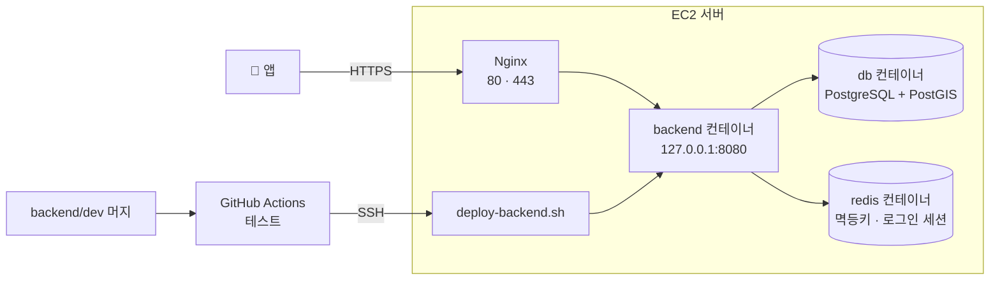
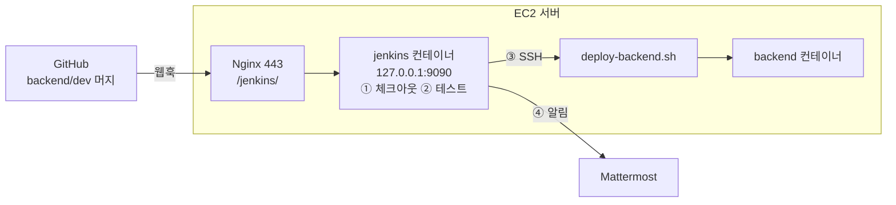

# 여기록 인프라

서버 한 대(EC2)에 Docker Compose로 DB와 백엔드(이후 AI 서버)를 띄우고, Nginx로 HTTPS를 붙이고, `backend/dev`에 머지되면 GitHub Actions가 자동으로 배포하는 구성입니다(10단계에서 Jenkins로 옮기는 중). 인프라를 처음 맡는 사람이 위에서부터 순서대로 따라 하면 되도록 썼습니다.

## 한눈에 보기



- 바깥에서 들어오는 길은 **Nginx(80·443) 하나**입니다. DB(5432)와 백엔드(8080)는 서버 안에서만 열립니다. Redis는 포트를 열지 않고 compose 내부망으로만 백엔드와 붙습니다.
- 테이블은 **백엔드의 Flyway(마이그레이션)만** 만듭니다. AI 서버도 같은 DB를 쓰지만 테이블을 만들지 않습니다.
- 역할 경계: 컨테이너 바깥(서버, 도메인, HTTPS, DB 인스턴스, 배포, 비밀값)은 인프라, 컨테이너 안(코드, 스키마, 설정 프로필)은 각 파트가 맡습니다.

## 파일

| 파일 | 하는 일 | 쓰는 곳 |
| --- | --- | --- |
| `infra/docker-compose.local.yml` | 로컬 개발용 DB·Redis | 팀원 노트북 |
| `infra/docker-compose.yml` | 서버의 DB·Redis·백엔드(·AI) 구성 | 서버 |
| `infra/.env.example` | 서버 비밀값 목록 (값은 비워 둠) | 서버에서 `.env`로 복사 |
| `infra/nginx/yeogirok.conf` | HTTPS·업로드 한도·타임아웃 | 서버 `/etc/nginx` |
| `infra/nginx/jenkins.conf` | `https://<도메인>/jenkins/`를 Jenkins로 연결 | 서버 `/etc/nginx/snippets` |
| `infra/scripts/deploy-backend.sh` | 최신 코드(또는 넘겨받은 커밋)로 백엔드 다시 띄우고 확인 | 서버 (Actions·Jenkins가 실행) |
| `infra/scripts/backup-db.sh` | DB 백업, 오래된 백업 정리 | 서버 (cron) |
| `infra/jenkins/docker-compose.yml` | Jenkins 컨테이너 (앱과 따로 켜고 끔) | 서버 |
| `infra/jenkins/backend.Jenkinsfile` | 백엔드 테스트 → 배포 → 알림 파이프라인 | Jenkins job `yeogirok-backend` |

다른 파트 폴더에 들어가야 하는 파일이 있습니다. 직접 커밋하지 말고 **`backend/dev`로 PR을 보내 백엔드 리뷰를 받습니다.**

| 파일 | 이유 |
| --- | --- |
| `backend/Dockerfile`, `backend/.dockerignore` | 백엔드 이미지를 만드는 방법 |
| `backend/src/main/resources/application-prod.yaml` | 서버용 설정 프로필 (DB 접속, 프록시 헤더) |
| `.github/workflows/deploy-backend.yml` | 자동 배포. push로 실행되는 워크플로는 **push된 브랜치에 있는 파일**을 쓰기 때문에 `backend/dev`에 있어야 동작합니다 |

## 진행 순서

| 단계 | 내용 | 시간 | 언제 | 끝났다는 기준 |
| --- | --- | --- | --- | --- |
| 0 | 준비물 확인 | 10분 | 10/29(목) | 서버 접속 정보와 도메인 확보 |
| 1 | 로컬 DB·Redis | 30분 | 10/29(목) | 백엔드가 `.env` 없이 로컬에서 실행됨 |
| 2 | 서버 기본 세팅 | 1시간 | 10/29(목) | 서버에서 `docker run hello-world` 성공 |
| 3 | 코드와 비밀값 | 20분 | 10/30(금) | `~/yeogirok` 폴더 구조와 `.env` |
| 4 | 백엔드 첫 실행 | 1시간 | 10/30(금) | 서버 안에서 응답 200 |
| 5 | Nginx와 HTTPS | 40분 | 10/30(금) | `https://<도메인>/swagger-ui.html` 열림 |
| 6 | 자동 배포 | 1시간 | 10/30(금) | `backend/dev` 머지 후 5분 안에 반영 |
| 7 | Flyway 도입 | 30분 | V1이 나오는 날 | `flyway_schema_history`에 V1 기록 |
| 8 | 백업 | 15분 | 11/2(월) | 매일 백업 파일 생성 |
| 9 | AI 서버·파일 저장소·Redis·외부 키 | — | 11/2~4 | 영수증 1장 업로드 → OCR 결과, Redis `(healthy)` |
| 10 | Jenkins CI/CD (선택) | 2~3시간 | — | `backend/dev` 머지 → Jenkins 빌드 성공 → Mattermost 알림 |

## 먼저 알아둘 말 6개

| 말 | 뜻 |
| --- | --- |
| 이미지 | 프로그램과 실행 환경을 통째로 묶은 설치 파일. `Dockerfile`로 만든다 |
| 컨테이너 | 이미지를 실행한 것. 지우고 다시 만들어도 같은 상태로 뜬다 |
| 볼륨 | 컨테이너를 지워도 남는 저장 공간. DB 데이터는 여기에 둔다 |
| Docker Compose | 컨테이너 여러 개(DB, 백엔드…)를 파일 하나로 정의하고 한 번에 켜고 끄는 도구 |
| 리버스 프록시 | 바깥 요청을 받아 안쪽 서버에 넘겨주는 문지기. 여기서는 Nginx가 HTTPS를 처리하고 백엔드에 넘긴다 |
| CI/CD | 코드를 올리면 자동으로 테스트(CI)하고 서버에 반영(CD)하는 것 |

---

## 0단계. 준비물 확인

- **서버 접속 정보**: `.pem` 키 파일, 서버 주소, 계정 이름(Ubuntu 서버면 보통 `ubuntu`)
- **도메인**: 서버 IP에 연결된 도메인. HTTPS 인증서는 IP가 아니라 도메인에 발급됩니다. 받은 도메인이 없으면 DuckDNS 같은 무료 도메인을 연결합니다.
- **열린 포트**: 22(SSH), 80(HTTP), 443(HTTPS). AWS 보안 그룹에서 막혀 있으면 5·6단계가 실패합니다. 서버를 받은 곳(운영진)에 확인합니다.
- **내 노트북**: Docker Desktop (1단계용)

---

## 1단계. 로컬 DB·Redis (내 노트북, 30분)

**왜**: 팀원마다 DB 종류나 버전이 다르면 "내 컴퓨터에선 되는데"가 생깁니다. 모두 같은 이미지, 같은 계정으로 맞춥니다.

저장소 루트에서:

```bash
docker compose -f infra/docker-compose.local.yml up -d
docker compose -f infra/docker-compose.local.yml ps   # db, redis 모두 STATUS 가 (healthy) 면 성공
```

Redis가 응답하는지 확인합니다. `PONG`이 나오면 성공입니다.

```bash
docker compose -f infra/docker-compose.local.yml exec redis redis-cli ping
```

- DB는 `localhost:5432`, Redis는 `localhost:6379`(비밀번호 없음)로 붙습니다.
- Redis는 로컬 전용이라 비밀번호·메모리 정책·영속성을 설정하지 않았습니다. `down`으로 컨테이너를 지우면 Redis 데이터도 사라집니다. 서버 Redis 설정은 서버 담당이 따로 맡습니다.
- 내 PC에 이미 Redis가 6379 포트로 떠 있으면 충돌합니다. 그 Redis를 끄고 다시 실행합니다.

백엔드를 실행해 봅니다. 접속 정보가 `application-local.yaml`의 기본값과 같아서 `.env` 없이 바로 뜹니다.

```bash
cd backend
./gradlew bootRun
# 브라우저: http://localhost:8080/swagger-ui.html
```

- Apple Silicon Mac에서 이미지를 못 받으면 `docker-compose.local.yml`의 `platform: linux/amd64` 주석을 풉니다.
- 이 파일을 `infra/dev` → `main`으로 올린 뒤, 백엔드는 `main`을 `backend/dev`에 한 번 머지하면 같은 파일을 쓸 수 있습니다.

---

## 2단계. 서버 접속과 기본 세팅 (1시간)

### 2-1. 접속

```bash
chmod 400 ~/Downloads/<키파일>.pem
ssh -i ~/Downloads/<키파일>.pem ubuntu@<도메인>
```

Windows는 PowerShell이나 Git Bash에서 같은 명령을 씁니다.

### 2-2. 서버 사양 확인

```bash
lsb_release -ds      # Ubuntu 버전
nproc                # CPU 개수
free -h              # 메모리
df -h /              # 디스크
```

### 2-3. 시간대와 패키지 업데이트

```bash
sudo timedatectl set-timezone Asia/Seoul
sudo apt-get update && sudo apt-get -y upgrade
```

### 2-4. 스왑 (메모리가 8GB 이하일 때)

**왜**: Gradle 빌드와 OCR은 메모리를 많이 씁니다. 모자라면 빌드가 `Killed`로 멈춥니다. 디스크 일부를 비상용 메모리로 씁니다.

```bash
sudo fallocate -l 4G /swapfile
sudo chmod 600 /swapfile
sudo mkswap /swapfile
sudo swapon /swapfile
echo '/swapfile none swap sw 0 0' | sudo tee -a /etc/fstab   # 재부팅 후에도 유지
free -h                                                      # Swap 4.0Gi 확인
```

### 2-5. Docker 설치 (Docker 공식 저장소 방식)

```bash
sudo apt-get install -y ca-certificates curl
sudo install -m 0755 -d /etc/apt/keyrings
sudo curl -fsSL https://download.docker.com/linux/ubuntu/gpg -o /etc/apt/keyrings/docker.asc
sudo chmod a+r /etc/apt/keyrings/docker.asc
echo "deb [arch=$(dpkg --print-architecture) signed-by=/etc/apt/keyrings/docker.asc] https://download.docker.com/linux/ubuntu $(. /etc/os-release && echo "${UBUNTU_CODENAME:-$VERSION_CODENAME}") stable" | sudo tee /etc/apt/sources.list.d/docker.list > /dev/null
sudo apt-get update
sudo apt-get install -y docker-ce docker-ce-cli containerd.io docker-buildx-plugin docker-compose-plugin

sudo usermod -aG docker $USER   # sudo 없이 docker 쓰기
exit                            # 다시 접속해야 적용된다
```

다시 접속한 뒤:

```bash
docker run --rm hello-world     # "Hello from Docker!" 가 나오면 성공
docker compose version
```

### 2-6. 방화벽

```bash
sudo ufw status
```

- `inactive`면 AWS 보안 그룹만 확인하면 됩니다.
- `active`면 80·443을 엽니다: `sudo ufw allow 80/tcp && sudo ufw allow 443/tcp`
- **22번(SSH)을 막는 명령은 절대 쓰지 않습니다.** 접속이 끊기면 다시 들어올 방법이 없습니다.
- Docker는 ufw 규칙을 건너뛰고 포트를 엽니다. 그래서 `docker-compose.yml`의 포트는 모두 `127.0.0.1:`로 시작합니다. 이 부분을 지우면 DB가 인터넷에 노출됩니다.

---

## 3단계. 코드와 비밀값 (20분)

**왜 따로 받나**: 백엔드 코드는 `backend/dev`, 인프라 설정은 `infra/dev`에 있습니다. 한 폴더는 한 브랜치만 가리킬 수 있어서 브랜치별로 따로 받습니다. 공개 저장소라 로그인 없이 받아집니다.

먼저 이 폴더의 파일을 `infra/dev`에 올려 둡니다. 브랜치 규칙대로 `infra/chore/<이슈키>-docker-compose` 같은 기능 브랜치에서 커밋하고 `infra/dev`로 PR합니다. 커밋 전에 스크립트에 실행 권한을 줍니다: `chmod +x infra/scripts/*.sh`. 그다음 서버에서:

```bash
mkdir -p ~/yeogirok && cd ~/yeogirok
git clone --single-branch --branch infra/dev   https://github.com/SSAFY-A109/Yeogirok.git infra-src
git clone --single-branch --branch backend/dev https://github.com/SSAFY-A109/Yeogirok.git backend-src
```

```
~/yeogirok/
├─ infra-src/infra/      compose · 스크립트 · .env       (infra/dev)
├─ backend-src/backend/  백엔드 코드                     (backend/dev)
└─ backups/              DB 백업                         (8단계에서 생김)
```

비밀값 파일을 만듭니다.

```bash
cd ~/yeogirok/infra-src/infra
cp .env.example .env
openssl rand -hex 24         # 나온 값을 DB_PASSWORD 에 넣는다
openssl rand -hex 24         # 한 번 더 만들어 다른 값을 REDIS_PASSWORD 에 넣는다
openssl rand -base64 48      # JWT_SECRET 에 넣는다 (이것만 base64)
nano .env                    # 저장: Ctrl+O, Enter / 나가기: Ctrl+X
chmod 600 .env               # 나만 읽을 수 있게
```

- `.env`는 커밋하지 않습니다(`infra/.gitignore`에 들어 있음). 노션에는 키 **이름**과 발급처만 적고 값은 적지 않습니다.
- 비밀번호는 `-hex`로 만듭니다(숫자와 a~f만 나옴). `-base64`는 `/`, `+` 같은 기호가 섞이는데, 9단계 AI 서버는 비밀번호를 DB 주소(`postgresql://계정:비밀번호@db:5432/...`) 안에 넣기 때문에 이런 기호가 있으면 주소가 깨질 수 있습니다.
- `JWT_SECRET`만 `-base64`로 만듭니다. 백엔드가 Base64로 읽고, DB 주소에 들어가지 않아 기호가 섞여도 괜찮습니다. 구글·카카오 키는 9단계 "로그인·방문 분포·위치 증거 값"을 봅니다.
- **`DB_PASSWORD`는 DB를 처음 만들 때만 적용됩니다.** 나중에 `.env`만 바꾸면 접속이 거부됩니다. 바꾸려면 7단계처럼 DB 볼륨을 지우고 다시 만듭니다.

---

## 4단계. 백엔드 첫 실행 (1시간)

**먼저 할 것**: `backend/Dockerfile`, `backend/.dockerignore`, `backend/src/main/resources/application-prod.yaml`을 `backend/dev`로 PR 보내고 머지합니다.

```bash
cd ~/yeogirok/backend-src && git pull
cd ~/yeogirok/infra-src/infra
docker compose up -d --build     # 첫 빌드는 5~10분 걸린다
docker compose ps                # db: (healthy), backend: Up 이면 정상
docker compose logs -f backend   # "Started YeogirokApplication" 이 보이면 Ctrl+C
curl -s -o /dev/null -w '%{http_code}\n' http://127.0.0.1:8080/v3/api-docs   # 200
```

방금 일어난 일:

1. `Dockerfile`대로 백엔드 이미지를 만들었다 (JDK로 빌드 → JRE만 담은 작은 이미지)
2. DB 컨테이너를 켜고, `pg_isready`로 준비될 때까지 기다렸다
3. DB가 준비된 뒤 백엔드를 `prod` 프로필로 켰다. DB 주소는 `db:5432`(컨테이너 이름이 주소가 된다)

---

## 5단계. Nginx와 HTTPS (40분)

**왜 Nginx를 컨테이너가 아니라 서버에 바로 설치하나**: `certbot`이 Nginx 설정에 HTTPS를 자동으로 붙이고 인증서도 자동으로 갱신해 줘서, 처음에는 이 방식이 가장 단순합니다.

```bash
sudo apt-get install -y nginx certbot python3-certbot-nginx

sudo cp ~/yeogirok/infra-src/infra/nginx/yeogirok.conf /etc/nginx/sites-available/yeogirok
sudo sed -i 's/YOUR_DOMAIN/<도메인>/' /etc/nginx/sites-available/yeogirok   # <도메인>을 실제 값으로
sudo ln -s /etc/nginx/sites-available/yeogirok /etc/nginx/sites-enabled/
sudo rm -f /etc/nginx/sites-enabled/default
sudo nginx -t && sudo systemctl reload nginx   # "syntax is ok" 확인

curl -s -o /dev/null -w '%{http_code}\n' http://<도메인>/v3/api-docs   # 200

sudo certbot --nginx -d <도메인>   # 이메일 입력, 약관 동의. HTTP→HTTPS 이동을 물으면 이동 선택
sudo certbot renew --dry-run        # 자동 갱신이 되는지 시험
```

브라우저에서 `https://<도메인>/swagger-ui.html`을 열고 아무 API나 **Try it out**으로 실행해 봅니다.

- 프론트에 알릴 값: `EXPO_PUBLIC_API_URL=https://<도메인>`. 프론트는 `EXPO_PUBLIC_LIVE_DOMAINS`로 배포된 도메인(예: `auth`)부터 실서버로 바꿀 수 있습니다.

---

## 6단계. 자동 배포 (1시간)

**왜**: 백엔드가 머지할 때마다 서버에 들어와 명령을 치면 인프라 담당이 병목이 됩니다. `backend/dev`에 머지되면 GitHub Actions가 테스트하고, SSH로 서버에 들어가 `deploy-backend.sh`를 실행합니다. GitHub Actions는 공개 저장소에서 무료입니다.

### 6-1. 배포 전용 SSH 키 만들기 (내 노트북)

`.pem` 키를 GitHub에 올리지 않고, 배포용 키를 따로 만듭니다. 문제가 생기면 이 키만 지우면 됩니다.

```bash
ssh-keygen -t ed25519 -C "yeogirok-deploy" -f ./yeogirok_deploy -N ""
cat ./yeogirok_deploy.pub     # 공개키 한 줄 복사
```

서버에서 공개키를 등록합니다.

```bash
echo '<복사한 공개키 한 줄>' >> ~/.ssh/authorized_keys
```

노트북에서 접속을 시험합니다: `ssh -i ./yeogirok_deploy ubuntu@<도메인> 'echo ok'`

### 6-2. GitHub Secrets 등록

저장소 **Settings → Secrets and variables → Actions → New repository secret**

| 이름 | 값 |
| --- | --- |
| `SSH_HOST` | `<도메인>` |
| `SSH_USER` | `ubuntu` |
| `SSH_KEY` | `yeogirok_deploy` 파일 내용 전체 (`-----BEGIN`부터 `END-----`까지) |

등록한 뒤 노트북의 개인키 파일은 지웁니다. 다시 필요하면 새로 만들면 됩니다.

### 6-3. 워크플로 파일 넣기

`.github/workflows/deploy-backend.yml`을 **`backend/dev`로 PR**합니다. push로 실행되는 워크플로는 push된 브랜치에 있는 파일을 쓰기 때문입니다.

### 6-4. 확인

저장소 **Actions → deploy-backend → Run workflow**로 한 번 수동 실행합니다. 두 작업(test, deploy)에 초록 체크가 뜨고 로그 끝에 `[deploy] 성공`이 보이면 끝입니다. 이후에는 `backend/dev`에 머지될 때마다 자동으로 실행됩니다.

### 6-5. 플랜 B: GitHub에서 서버로 SSH가 막혀 있을 때

Actions 로그에 `i/o timeout`이 보이면 보안 그룹이 22번을 특정 IP에만 열어 둔 것입니다. 이때는 서버가 2분마다 스스로 새 커밋을 확인하게 합니다.

```bash
crontab -e
# 맨 아래에 한 줄 추가
*/2 * * * * bash $HOME/yeogirok/infra-src/infra/scripts/deploy-backend.sh --if-changed >> $HOME/yeogirok/deploy.log 2>&1
```

배포 기록은 `tail -f ~/yeogirok/deploy.log`로 봅니다. 이 경우 워크플로에서는 `deploy` 작업을 지우고 `test`만 남깁니다.

---

## 7단계. Flyway 도입 (백엔드와 함께, 30분)

백엔드가 아래를 `backend/dev`에 넣는 날 진행합니다.

- 의존성 `spring-boot-starter-flyway`와 `flyway-database-postgresql`. Spring Boot 4는 `flyway-core`만 넣으면 오류 없이 마이그레이션이 실행되지 않습니다.
- `src/main/resources/db/migration/V1__init.sql`
- `application-prod.yaml`의 `ddl-auto`를 `validate`로 변경

**왜 DB를 한 번 비우나**: 지금까지 `update`로 만든 테이블이 남아 있으면 Flyway가 "기록 없는 테이블이 있다"며 시작을 거부합니다. 개발용 데이터라 비우고 처음부터 만드는 게 가장 깔끔합니다.

```bash
cd ~/yeogirok/infra-src/infra
bash scripts/backup-db.sh                      # 혹시 모르니 백업
docker compose stop backend
docker compose rm -sf db
docker volume rm yeogirok_db-data              # DB 데이터 삭제
docker compose up -d db
bash scripts/deploy-backend.sh                 # 새 코드로 백엔드 띄우기 (이때 V1 적용)

docker compose exec db sh -c 'psql -U "$POSTGRES_USER" -d "$POSTGRES_DB" -c "select version, description, success from flyway_schema_history"'
```

팀원 로컬 DB도 한 번 비웁니다: `docker compose -f infra/docker-compose.local.yml down -v && docker compose -f infra/docker-compose.local.yml up -d`

Flyway 규칙(백엔드 공유): 파일 이름은 `V{번호}__{설명}.sql`, 한 번 적용된 파일은 고치지 않고 새 번호로 수정합니다.

---

## 8단계. 백업 (15분)

```bash
bash ~/yeogirok/infra-src/infra/scripts/backup-db.sh    # 지금 한 번
ls -lh ~/yeogirok/backups

crontab -e
# 매일 새벽 4시 백업, 7일 지난 백업 자동 삭제
0 4 * * * bash $HOME/yeogirok/infra-src/infra/scripts/backup-db.sh >> $HOME/yeogirok/backup.log 2>&1
```

복구:

```bash
cd ~/yeogirok/infra-src/infra
gunzip -c ~/yeogirok/backups/<파일>.sql.gz | docker compose exec -T db sh -c 'psql -U "$POSTGRES_USER" -d "$POSTGRES_DB"'
```

---

## 9단계. 다음 주에 붙일 것 (11/2~3)

**AI 서버**
- FastAPI 앱과 `ai/Dockerfile`이 준비되면 `docker-compose.yml`의 `ai` 주석을 풉니다.
- 서버에 `ai/dev`를 따로 받습니다: `git clone --single-branch --branch ai/dev https://github.com/SSAFY-A109/Yeogirok.git ~/yeogirok/ai-src`
- 배포 스크립트와 워크플로는 백엔드 것을 복사해 `backend`를 `ai`로 바꿉니다.
- `ai/ocr/requirements.txt`는 GPU용 `paddlepaddle-gpu`를 씁니다. GPU가 없는 서버에서는 CPU용 `paddlepaddle`로 설치해야 합니다.
- 백엔드는 `http://ai:8000`으로 부릅니다. AI 서버 포트는 바깥에 열지 않습니다.

**파일 저장소 (API-012 업로드, API-086 완료 확인, API-013 조회)**
- 사진·영수증 파일은 **S3에 저장합니다** (2026-11-02 결정). 서버 디스크에는 저장하지 않습니다.
- 버킷은 사진과 영수증을 나눕니다 (2026-11-03 분리). 영수증은 결제 정보라 보관 기간·암호화·공개 범위를 사진과 따로 정하기 위해서입니다. 모두 서울 리전, 퍼블릭 액세스 차단, SSE-S3 암호화입니다.

  | 용도 | 개발용 (`yeogirok-dev`) | 서버용 (`yeogirok-server-prod`) |
  | --- | --- | --- |
  | 사진 | `yeogirok-a109-photos-dev` | `yeogirok-a109-photos-prod` |
  | 영수증 | `yeogirok-a109-receipts-dev` | `yeogirok-a109-receipts-prod` |

- 수명 주기 규칙으로 파일이 자동 삭제됩니다. S3 규칙은 하루 한 번 돌아서 실제로는 업로드 1~2일 뒤에 지워집니다.

  | 버킷 | 자동 삭제 대상 | 백엔드가 지킬 것 |
  | --- | --- | --- |
  | 사진 | `tmp/` 아래 파일만, 1일 뒤 | 임시 업로드는 반드시 `tmp/` 아래에 올리고, 확정할 때 `tip-photo/`·`record-photo/`로 옮깁니다. 옮기지 않으면 하루 뒤에 사라집니다. |
  | 영수증 | 버킷의 모든 파일, 1일 뒤 | 하루 안에 OCR 등 처리를 끝내고 필요한 데이터는 DB에 저장합니다. 원본은 다시 꺼내 쓸 수 없습니다. API-012의 24시간 보관 기한은 S3 삭제보다 먼저 끝나므로, 기한이 지나면 백엔드가 직접 접근을 막습니다. |

- 서버는 서버 전용 IAM 사용자의 접근 키로 S3에 접근합니다. 값은 서버 `.env`에 넣고, 키 이름은 `.env.example`의 `AWS_*`, `S3_PHOTO_BUCKET`, `S3_RECEIPT_BUCKET`을 참고합니다. 백엔드는 파일 종류에 따라 버킷을 골라 Presigned URL을 발급합니다.
- 접근 키는 Git·노션·메신저에 올리지 않습니다.
- 앱은 서버가 발급한 Presigned URL로 S3에 직접 올리고 받으므로 파일이 Nginx·백엔드를 거치지 않습니다. Nginx `client_max_body_size`와 Spring multipart 한도는 파일 업로드와 관계없고, 허용 크기는 백엔드 설정값으로 정합니다.
- 구성과 확인 방법: [여기록 S3 파일 저장소 구성 가이드](https://claude.ai/artifact/9aLhLYienyLD2TevfE43Xh)

**Redis (멱등키·로그인 세션, 2026-11-04)**
- 백엔드는 같은 요청이 두 번 처리되지 않게 하는 멱등키와 로그인 세션을 Redis에 둡니다(백엔드 S15P31A109-106). 서버 Redis는 `docker-compose.yml`의 `redis` 서비스입니다.

  | 설정 | 값 | 이유 |
  | --- | --- | --- |
  | 버전 | `redis:7.4-alpine` | 로컬 compose와 같게 |
  | 비밀번호 | `.env`의 `REDIS_PASSWORD` (`openssl rand -hex 24`) | 비어 있으면 compose가 멈춘다 |
  | 포트 | 열지 않음 | 백엔드만 compose 내부망(`redis:6379`)으로 접속 |
  | 메모리 | 256MB, `noeviction` | 꽉 차도 멱등키·세션을 몰래 지우지 않고 쓰기를 거부 |
  | 영속성 | AOF(`appendonly yes`), `redis-data` 볼륨 | 재시작·배포 뒤에도 키가 남음 |
  | 멱등키 | 보관 `24h`, 처리 중 표시 `30s` | 보관은 11/3 결정, 처리 중은 백엔드 제안값 |

- **순서를 지킵니다.** 백엔드 `prod` 프로필은 Redis 값이 없으면 바로 멈추고, `backend/dev`에 머지되면 자동 배포가 바로 돕니다. 배포 스크립트는 서버의 infra 코드를 받아 오지 않습니다.
  1. 이 변경을 `infra/dev`에 머지합니다.
  2. 서버에서 infra 코드를 받고 **바로 이어서** `.env`에 비밀번호를 넣습니다. 받은 뒤 비밀번호가 없으면 `docker compose`가 `required variable REDIS_PASSWORD is missing a value`로 멈춰서 배포·백업도 같이 멈춥니다.
  3. Redis를 켜고 확인한 뒤 백엔드에 머지해도 된다고 알립니다.

```bash
cd ~/yeogirok/infra-src && git pull
cd infra
grep -c '^REDIS_PASSWORD=' .env     # 0 이어야 한다
printf '\nREDIS_PASSWORD=%s\n' "$(openssl rand -hex 24)" >> .env
grep -c '^REDIS_PASSWORD=' .env     # 1 이면 정상
docker compose up -d redis
docker compose ps redis             # (healthy) 가 보이면 정상
docker compose exec redis redis-cli ping
docker compose exec redis redis-cli config get maxmemory-policy
```

- `ping`은 `PONG`, 마지막 줄은 `noeviction`이 나와야 합니다. 비밀번호는 `REDISCLI_AUTH`로 넘겨 두어서 `redis-cli`에 따로 치지 않습니다.
- 지금 백엔드는 그대로 둬도 됩니다. 백엔드 PR이 머지되면 자동 배포가 새 설정(환경 변수, Redis 대기)으로 백엔드를 다시 만듭니다.
- 비밀번호는 DB와 달리 나중에 바꿔도 됩니다. `.env`를 고친 뒤 `docker compose up -d redis backend`로 둘 다 다시 만듭니다.

**로그인·방문 분포·위치 증거 값 (2026-11-05)**
- 11/4 백엔드 PR 두 개(회원 API #47, 발자취 API #46)가 prod에서 기본값 없이 받는 값 10개를 추가했습니다. 서버 compose가 이 값을 넘기지 않아 그날 자동 배포가 계속 실패했고, 이제 `docker-compose.yml`이 넘깁니다.

  | 값 | 넣는 곳 | 비고 |
  | --- | --- | --- |
  | `JWT_SECRET` | 서버 `.env` | `openssl rand -base64 48`. 서버에서만 만든다 |
  | `GOOGLE_WEB_CLIENT_ID` | 서버 `.env` | 구글 **웹** 클라이언트 ID. 앱의 `webClientId`와 같은 값 |
  | `KAKAO_APP_KEY` | 서버 `.env` | 카카오 **네이티브 앱 키**. 앱 카카오 SDK와 같은 값 |
  | `VISIT_STATS_*` 4개, `LOCATION_*` 3개 | `docker-compose.yml` | 비밀 값이 아니다. TBD: 팀이 정하기 전이라 백엔드 로컬 제안값(11/4)을 임시로 넣었다 |

- 구글·카카오 키가 아직 없으면 임시 문자열을 넣습니다. 백엔드는 뜨고 그 제공자 로그인만 실패합니다.
- **순서**: 이 변경을 `infra/dev`에 머지 → 서버에서 infra 코드를 받고 `.env`에 세 값을 넣기 → 백엔드 다시 배포. 위의 Redis를 아직 반영하지 않았다면 그것부터 합니다.

```bash
cd ~/yeogirok/infra-src && git pull
cd infra
grep -cE '^(JWT_SECRET|GOOGLE_WEB_CLIENT_ID|KAKAO_APP_KEY)=' .env    # 0 이어야 한다
printf '\nJWT_SECRET=%s\n' "$(openssl rand -base64 48)" >> .env
nano .env    # 맨 아래에 GOOGLE_WEB_CLIENT_ID=<값>, KAKAO_APP_KEY=<값> 두 줄을 추가한다
grep -cE '^(JWT_SECRET|GOOGLE_WEB_CLIENT_ID|KAKAO_APP_KEY)=' .env    # 3 이면 정상
bash scripts/deploy-backend.sh     # 마지막에 "[deploy] 성공" 이 보이면 끝
```

- `JWT_SECRET`을 바꾸면 이미 발급된 액세스 토큰이 모두 무효가 됩니다. 한 번 만든 뒤에는 바꾸지 않습니다.
- **앞으로**: 백엔드가 prod 프로필에 기본값 없는 값을 추가하면, 그 값을 compose와 서버 `.env`에 먼저 넣은 뒤 백엔드 PR을 머지합니다. 순서가 바뀌면 머지 즉시 자동 배포가 돌아 백엔드가 멈춥니다.

**외부 키 추가하는 법**
1. 서버 `.env`에 `KEY=값` 추가
2. `docker-compose.yml`의 해당 서비스 `environment`에 `KEY: ${KEY}` 한 줄 추가 (이 파일은 `infra/dev`로 커밋)
3. 서버에서 `git -C ~/yeogirok/infra-src pull && docker compose up -d backend` (설정이 바뀐 컨테이너만 다시 만들어진다)

---

## 10단계. Jenkins로 CI/CD (선택, 2~3시간)

**왜**: 6단계의 GitHub Actions도 잘 돌고 있습니다. Jenkins는 회사에서 가장 많이 쓰는 CI/CD 도구라 직접 설치하고 운영해 보려고 붙입니다. Actions는 GitHub가 빌려주는 컴퓨터에서 돌지만, Jenkins는 **우리 서버에 직접 설치한 프로그램**이라 설치·보안·업데이트까지 우리가 맡습니다.

**먼저**: 백엔드가 정상(`https://<도메인>/v3/api-docs`가 200)인 상태에서 시작합니다. 10-5의 첫 실행이 실제로 서버에 배포까지 하기 때문입니다.

### Jenkins 말 8개

| 말 | 뜻 | Actions에서는 |
| --- | --- | --- |
| Jenkins | 서버에 떠 있는 자동 작업 실행기. 신호가 오면 정해진 순서대로 명령을 실행하고 기록을 남긴다 | GitHub Actions |
| Job | 할 일 하나. 여기서는 `yeogirok-backend` | 워크플로 |
| 빌드(Build) | Job을 한 번 실행한 것. `#1`, `#2`처럼 번호가 붙는다 | 워크플로 실행(run) |
| 파이프라인, Jenkinsfile | 할 일을 단계별로 코드로 적은 것, 그리고 그 파일 | `.github/workflows/*.yml` |
| Stage | 파이프라인 안의 한 단계. 여기서는 체크아웃·테스트·배포 | job·step |
| 플러그인 | Jenkins에 기능을 더하는 확장. 화면에서 앱처럼 설치한다 | `uses:`로 가져오는 액션 |
| Credentials | 비밀값 금고. 파이프라인에서 ID로 꺼내 쓰고, 로그에는 `****`로 가려진다 | Secrets |
| 웹훅 | GitHub가 "push가 생겼다"고 Jenkins 주소로 보내는 알림 | `on: push` |

### 구성



- Jenkins는 앱과 **다른 compose 파일**(`infra/jenkins/docker-compose.yml`)로 띄웁니다. 앱을 다시 띄워도 Jenkins는 그대로이고, 반대도 마찬가지입니다.
- 도메인이 하나라 `https://<도메인>/jenkins/` 경로로 엽니다. 새 포트는 열지 않습니다.
- 배포는 Jenkins가 SSH로 서버에 들어가 `deploy-backend.sh`를 실행합니다. Actions와 같은 방식이라 손으로 배포할 때와 결과가 같습니다. 이때 **방금 테스트한 커밋**을 `DEPLOY_SHA`로 넘겨서, 그사이 새 커밋이 들어와도 테스트하지 않은 코드가 나가지 않습니다. 다른 배포(Actions나 수동 배포)가 돌고 있으면 끝날 때까지 기다렸다가 배포합니다.
- 파이프라인 파일은 `infra/dev`에 둡니다(`infra/jenkins/backend.Jenkinsfile`). Actions 워크플로처럼 `backend/dev`에 넣지 않아도 되어서, 인프라가 백엔드 PR 없이 고칠 수 있습니다.

### 10-1. Jenkins 켜기 (서버, 15분)

이 변경이 `infra/dev`에 머지된 뒤 서버에서 실행합니다. `git pull`은 앱 compose 변경도 함께 받으니, 9단계에서 안내한 `.env` 값이 다 들어 있는지 먼저 확인합니다.

```bash
cd ~/yeogirok/infra-src && git pull
cd infra/jenkins
echo "DOCKER_GID=$(getent group docker | cut -d: -f3)" > .env
cat .env                    # DOCKER_GID=숫자 한 줄이면 정상
docker compose up -d
docker compose logs -f      # "Jenkins is fully up and running" 이 보이면 Ctrl+C
```

- `DOCKER_GID`는 서버 docker 그룹 번호입니다. 백엔드 테스트가 Redis 컨테이너를 띄울 때 Jenkins가 서버 Docker를 써야 해서 넣습니다.
- 처음에는 이미지를 받느라 1~2분 걸립니다. Jenkins와 테스트는 메모리를 최대 4GB까지 씁니다.

### 10-2. Nginx에 /jenkins/ 연결 (서버, 10분)

certbot이 고친 서버 Nginx 파일은 덮어쓰지 않고, Jenkins 설정 조각을 따로 복사한 뒤 `include` 한 줄만 넣습니다.

```bash
CONF=/etc/nginx/sites-available/yeogirok
sudo cp $CONF ~/nginx-yeogirok.bak
SNIP=/etc/nginx/snippets/yeogirok-jenkins.conf
sudo cp ~/yeogirok/infra-src/infra/nginx/jenkins.conf $SNIP
grep -c 'location / {' $CONF        # 1 이어야 한다
sudo sed -i '/location \/ {/i include snippets/yeogirok-jenkins.conf;' $CONF
grep -n 'include snippets' $CONF    # 한 줄 보이면 정상
sudo nginx -t                       # "syntax is ok"
sudo systemctl reload nginx
```

브라우저에서 `https://<도메인>/jenkins/`를 열어 **Unlock Jenkins** 화면이 나오면 성공입니다. `nginx -t`가 실패하면 백업으로 되돌립니다: `sudo cp ~/nginx-yeogirok.bak $CONF`

### 10-3. 처음 설정 (브라우저, 20분)

1. 잠금 해제 비밀번호를 서버에서 확인해 붙여 넣습니다.
   ```bash
   cd ~/yeogirok/infra-src/infra/jenkins
   docker compose exec jenkins cat /var/jenkins_home/secrets/initialAdminPassword
   ```
2. **Install suggested plugins**를 누릅니다. 5분쯤 걸리고, 실패한 플러그인이 있으면 **Retry**를 누릅니다.
3. **Create First Admin User**에서 관리자 계정을 만듭니다. 화면이 인터넷에 열려 있으니 비밀번호는 길게 만듭니다(`openssl rand -base64 18`).
4. **Instance Configuration**의 Jenkins URL에 `https://<도메인>/jenkins/`를 넣습니다. 알림에 붙는 빌드 링크가 이 주소로 만들어집니다.
5. **Manage Jenkins → Plugins → Available plugins**에서 `Generic Webhook Trigger`를 찾아 설치합니다. 웹훅 내용을 읽어 `backend/dev`일 때만 빌드하는 데 씁니다.
6. **Manage Jenkins → Security**에서 두 가지를 확인합니다.
   - Security Realm: Jenkins' own user database, **Allow users to sign up이 꺼짐**
   - Authorization: Logged-in users can do anything, **Allow anonymous read access가 꺼짐**

Jenkins 관리자는 Docker를 통해 서버 전체를 다룰 수 있습니다. 계정은 꼭 필요한 사람에게만 만듭니다.

### 10-4. 비밀값 넣기 (Credentials, 20분)

**Manage Jenkins → Credentials → System → Global credentials (unrestricted) → Add Credentials**에서 세 개를 넣습니다.

**① 서버 SSH 키 (`server-ssh`)**: Jenkins가 배포할 때 서버에 들어가는 열쇠입니다. 6단계 Actions 키와 따로 만듭니다.

```bash
ssh-keygen -t ed25519 -C yeogirok-jenkins -f ~/jenkins_key -N ""
cat ~/jenkins_key.pub >> ~/.ssh/authorized_keys
cat ~/jenkins_key           # 출력 전체를 복사한다
```

| 칸 | 값 |
| --- | --- |
| Kind | SSH Username with private key |
| ID | `server-ssh` |
| Username | `ubuntu` |
| Private Key | Enter directly → Add → `-----BEGIN`부터 `END-----`까지 붙여 넣기 |

저장한 뒤 서버의 키 파일은 지웁니다: `rm ~/jenkins_key ~/jenkins_key.pub`

**② Mattermost 알림 주소 (`mattermost-webhook`)**
1. Mattermost 왼쪽 위 팀 메뉴 → **통합(Integrations)** → **Incoming Webhooks** → **추가**
2. 알림 받을 채널을 고르고 저장한 뒤, 나온 주소(`https://.../hooks/...`)를 복사합니다.
3. Jenkins에 Kind **Secret text**, ID `mattermost-webhook`, Secret에 그 주소를 넣습니다.

메뉴 이름은 Mattermost 버전과 언어에 따라 조금 다릅니다. 통합 메뉴가 안 보이면 팀 관리자 권한이 필요할 수 있습니다.

**③ 웹훅 토큰 (`github-webhook-token`)**: 아무나 웹훅 주소를 불러 빌드를 돌리지 못하게 주소 끝에 붙이는 비밀 문자열입니다. 저장소가 공개라 Jenkinsfile에는 쓰지 않습니다.

```bash
openssl rand -hex 20
```

Kind **Secret text**, ID `github-webhook-token`, Secret에 위 값을 넣습니다. Jenkins에 넣은 값은 다시 볼 수 없으니 10-6을 마칠 때까지 터미널을 닫지 않습니다.

### 10-5. 파이프라인 만들고 첫 실행 (20분)

**연습 (선택, 5분)**: **New Item** → 이름 `hello` → **Pipeline** → OK → 맨 아래 Script 칸에 붙여 넣고 Save → **Build Now**. 단계가 화면에 어떻게 보이는지, ①의 SSH 키가 맞는지 확인하고 지워도 됩니다.

```groovy
pipeline {
    agent any
    stages {
        stage('인사') {
            steps { echo '안녕, Jenkins' }
        }
        stage('서버 접속 확인') {
            steps {
                withCredentials([sshUserPrivateKey(credentialsId: 'server-ssh', keyFileVariable: 'KEY', usernameVariable: 'SSH_USER')]) {
                    sh 'ssh -i "$KEY" -o StrictHostKeyChecking=accept-new "$SSH_USER@host.docker.internal" hostname'
                }
            }
        }
    }
}
```

**진짜 job**: **New Item** → 이름 `yeogirok-backend` → **Pipeline** → OK → 맨 아래 **Pipeline** 칸을 이렇게 채우고 Save → **Build Now**.

| 칸 | 값 |
| --- | --- |
| Definition | Pipeline script from SCM |
| SCM | Git |
| Repository URL | `https://github.com/SSAFY-A109/Yeogirok.git` |
| Credentials | - none - (공개 저장소) |
| Branch Specifier | `*/infra/dev` |
| Script Path | `infra/jenkins/backend.Jenkinsfile` |
| Lightweight checkout | 체크 |

- 빌드 번호(`#1`) → **Console Output**에서 진행을 봅니다. 첫 빌드는 Gradle이 의존성을 받느라 5~10분 걸리고, 다음부터는 캐시 덕분에 빨라집니다.
- 끝났다는 기준: 로그 끝에 `[deploy] 성공`과 `Finished: SUCCESS`, Mattermost에 `✅ 백엔드 배포 성공`, 빌드 화면에 **Test Result**.
- 같은 커밋으로 다시 빌드하면 Gradle이 이미 통과한 테스트를 건너뛰어(`UP-TO-DATE`) 테스트 단계가 몇 초 만에 끝납니다. 정상입니다.
- 첫 실행이 끝나야 Jenkinsfile의 웹훅 설정(`triggers`)이 Jenkins에 등록됩니다. 10-6은 그다음에 합니다.
- Jenkins는 빌드할 때마다 `infra/dev`에서 Jenkinsfile을 새로 읽습니다. 파이프라인을 고치려면 `infra/dev`로 PR을 머지하면 다음 빌드부터 적용됩니다.

### 10-6. GitHub 웹훅 연결 (10분)

저장소 **Settings → Webhooks → Add webhook**. Settings 탭은 저장소 관리자(admin)에게만 보입니다. 안 보이면 관리자에게 아래 값으로 등록을 부탁하고, 토큰은 개인 메시지로 전합니다.

| 칸 | 값 |
| --- | --- |
| Payload URL | `https://<도메인>/jenkins/generic-webhook-trigger/invoke?token=<10-4 ③ 토큰>` |
| Content type | **`application/json`** (기본값 form이면 Jenkins가 내용을 읽지 못한다) |
| Secret | 비움 |
| SSL verification | Enable |
| Which events | Just the push event |
| Active | 체크 |

- 저장하면 GitHub가 시험 신호(ping)를 보냅니다. 웹훅 화면 **Recent Deliveries**에 초록 체크가 보이면 연결된 것입니다.
- 이후 `backend/dev`에 머지되면 Jenkins에 빌드가 저절로 생깁니다. 다른 브랜치의 push도 웹훅은 오지만(응답 200) 빌드는 생기지 않습니다. 정상입니다.

### 10-7. GitHub Actions 배포 끄기

Jenkins가 실제 머지로 배포에 한 번 이상 성공하면 Actions를 끕니다. 둘 다 켜 두면 머지할 때마다 테스트와 배포가 두 번 돌고, 연달아 머지하면 잠깐 이전 커밋이 다시 배포될 수 있습니다.

1. `backend/dev`로 PR을 보내 `.github/workflows/deploy-backend.yml`을 지웁니다(백엔드 리뷰).
2. 저장소 Settings → Secrets에서 `SSH_HOST`·`SSH_USER`·`SSH_KEY`를 지웁니다.
3. 서버에서 Actions용 키를 지웁니다. 지금 SSH 창은 닫지 말고, 새 창으로 다시 접속되는지 확인합니다.

```bash
grep -c 'yeogirok-deploy' ~/.ssh/authorized_keys    # 1 이어야 한다
sed -i '/yeogirok-deploy$/d' ~/.ssh/authorized_keys
grep -c 'yeogirok-deploy' ~/.ssh/authorized_keys    # 0 이면 정상
```

### 다음에 붙일 것

- **배포 전 환경 변수 점검**: prod 프로필에 필요한 값이 compose와 `.env`에 다 있는지 배포 전에 확인합니다. 11/4 Redis 장애처럼 값이 빠져 백엔드가 멈추는 일을 막습니다.
- **자동 롤백**: 응답 확인이 실패하면 이전 이미지로 되돌립니다.
- **AI 서버**: `ai/Dockerfile`이 나오면 `backend.Jenkinsfile`을 복사해 AI용 job을 만듭니다.
- **Jenkins 업데이트**: 한 달에 한 번 `infra/jenkins`에서 `docker compose pull && docker compose up -d`, 화면에서 Manage Jenkins → Plugins → Updates.

---

## 자주 쓰는 명령

모두 서버의 `~/yeogirok/infra-src/infra`에서 실행합니다.

| 하고 싶은 것 | 명령 |
| --- | --- |
| 상태 보기 | `docker compose ps` |
| 백엔드 로그 실시간 | `docker compose logs -f backend` |
| 최근 로그 100줄 | `docker compose logs --tail 100 backend` |
| 백엔드 재시작 | `docker compose restart backend` |
| 수동 배포 | `bash scripts/deploy-backend.sh` |
| DB 접속(서버 안) | `docker compose exec db sh -c 'psql -U "$POSTGRES_USER" -d "$POSTGRES_DB"'` |
| Redis 접속(서버 안) | `docker compose exec redis redis-cli` (비밀번호는 자동으로 들어감) |
| Redis 메모리 사용량 | `docker compose exec redis redis-cli info memory \| grep used_memory_human` |
| DB 접속(내 노트북, DBeaver 등) | `ssh -i <키>.pem -L 15432:127.0.0.1:5432 ubuntu@<도메인>` 후 `localhost:15432`로 접속 |
| 디스크·Docker 용량 | `df -h /` · `docker system df` |
| 안 쓰는 이미지 정리 | `docker image prune -f` |
| 인증서 만료일 | `sudo certbot certificates` |
| Jenkins 상태·로그 | `docker compose -f jenkins/docker-compose.yml ps` · `docker compose -f jenkins/docker-compose.yml logs --tail 50` |
| Jenkins 재시작 | `docker compose -f jenkins/docker-compose.yml restart` |

## 문제가 생기면

| 증상 | 원인 | 해결 |
| --- | --- | --- |
| `permission denied ... docker.sock` | docker 그룹 추가 후 다시 접속하지 않음 | `exit` 후 다시 SSH 접속 |
| 브라우저에 502 Bad Gateway | 백엔드가 꺼져 있거나 아직 뜨는 중 | `docker compose ps`, `docker compose logs --tail 100 backend` |
| 업로드할 때 413 | 업로드 한도 초과 | Nginx `client_max_body_size`, Spring multipart 한도 확인 |
| Swagger Try it out이 "Failed to fetch" | HTTPS 뒤에서 http 주소로 요청 | `application-prod.yaml`의 `forward-headers-strategy: framework` 확인 |
| 빌드 중 `Killed` 또는 exit 137 | 메모리 부족 | 2-4 스왑 추가 |
| 백엔드가 DB 접속 거부(password authentication failed) | DB를 만든 뒤 `.env` 비밀번호만 바꿈 | 7단계처럼 DB 볼륨을 지우고 다시 만듦 |
| `docker compose` 명령마다 `required variable REDIS_PASSWORD is missing a value` | infra 코드를 받은 뒤 `.env`에 `REDIS_PASSWORD`를 넣지 않음 | 9단계 Redis대로 비밀번호 추가 |
| 배포 직후 backend가 `Restarting`을 반복하고 로그에 `For input string: "${REDIS_PORT}"`처럼 `${...}`가 그대로 찍힘 | 서버 infra 코드가 예전 것이라 compose가 백엔드에 Redis 값을 넘기지 않음 | `git -C ~/yeogirok/infra-src pull` 후 `git -C ~/yeogirok/infra-src log --oneline -1`로 받았는지 확인, 9단계 Redis대로 Redis를 켜고 `docker compose up -d backend` |
| 백엔드 로그에 `JWT_SECRET 환경 변수가 필요합니다` 또는 `허용 audience 가 비어 있습니다` | 서버 `.env`에 로그인 값이 없음 | 9단계 "로그인·방문 분포·위치 증거 값"대로 넣고 `docker compose up -d backend` |
| 백엔드 로그에 `JWT_SECRET 은 Base64 형식이어야 합니다` | 서버 infra 코드가 예전 것이라 값이 넘어가지 않았거나, 값을 잘못 붙여 넣음 | `git -C ~/yeogirok/infra-src log --oneline -1`로 최신인지 확인, `openssl rand -base64 48`로 다시 만듦 |
| 백엔드 오류에 `OOM command not allowed` | Redis 메모리 256MB가 다 참(`noeviction`이라 쓰기 거부) | `info memory`로 확인하고 `docker-compose.yml`의 `--maxmemory`를 늘림 |
| Flyway `non-empty schema ... without schema history table` | `update`로 만든 테이블이 남음 | 7단계 DB 비우기 |
| Flyway `checksum mismatch` | 이미 적용된 V 파일을 수정함 | 원래대로 되돌리고 새 번호 파일로 수정 |
| Actions의 SSH 단계가 `i/o timeout` | 22번이 GitHub에서 막힘 | 6-5 플랜 B |
| certbot 실패 (Timeout during connect) | 80번이 막혔거나 도메인이 다른 IP를 가리킴 | 보안 그룹 80번, `nslookup <도메인>` 확인 |
| `address already in use` (8080·5432) | 다른 프로그램이 포트 사용 중 | `sudo ss -ltnp \| grep -E '8080\|5432'` |
| `https://<도메인>/jenkins/`에 백엔드 404 화면이 나옴 | Nginx에 `include` 줄이 안 들어감 | 10-2의 `grep -n 'include snippets'`, `sudo nginx -t` |
| `https://<도메인>/jenkins/`가 502 | Jenkins가 꺼졌거나 켜지는 중 | `infra/jenkins`에서 `docker compose ps`, `docker compose logs --tail 50` |
| Jenkins 화면에 "reverse proxy setup is broken" | Jenkins URL이 실제 주소와 다름 | Manage Jenkins → System → Jenkins URL을 `https://<도메인>/jenkins/`로 |
| Jenkins 테스트 단계에 `Could not find a valid Docker environment` | Jenkins가 docker.sock을 쓸 권한이 없음 | `jenkins/.env`의 `DOCKER_GID`와 `getent group docker` 번호 비교, 고친 뒤 `docker compose up -d` |
| 노트북(Windows Docker Desktop)에 Jenkins를 띄우면 테스트가 `Could not connect to Ryuk`로 실패 | Docker Desktop은 Testcontainers가 여는 포트를 Windows 쪽에 열어서 Jenkins 컨테이너 안에서 닿지 않음. 서버(리눅스 Docker)에서는 생기지 않음(11/7 확인) | 노트북에서는 연습 job만 돌리고, 백엔드 파이프라인은 서버에서 돌림 |
| Jenkins 배포 단계에 `Permission denied (publickey)` | 서버에 공개키가 없거나 Credentials의 키가 잘림 | 10-4 ①을 새 키로 다시 |
| 웹훅 Recent Deliveries가 404 | 토큰이 다르거나 job을 한 번도 실행하지 않음 | 10-5 Build Now 후 토큰 확인 |
| 웹훅은 200인데 `backend/dev` 머지 후 빌드가 안 생김 | 웹훅 Content type이 form | 웹훅을 `application/json`으로 수정 |

## 시연 전 점검 (11/6)

- [ ] `https://<도메인>/swagger-ui.html` 열림
- [ ] 서버 재부팅 후에도 자동으로 다시 뜸 (`sudo reboot` → 2분 뒤 확인)
- [ ] `docker compose ps`에서 db·redis가 `(healthy)`
- [ ] `~/yeogirok/backups`에 매일 백업이 생김
- [ ] 인증서 만료일이 시연일 이후 (`sudo certbot certificates`)
- [ ] 디스크 여유 20% 이상 (`df -h /`)
- [ ] 시연 데이터를 넣고 백업 한 번 더
- [ ] 시연 전 배포 동결: Actions → deploy-backend → **Disable workflow** (cron을 썼다면 `crontab -e`에서 주석 처리, Jenkins를 쓰면 job 화면 → **Disable Project**)
